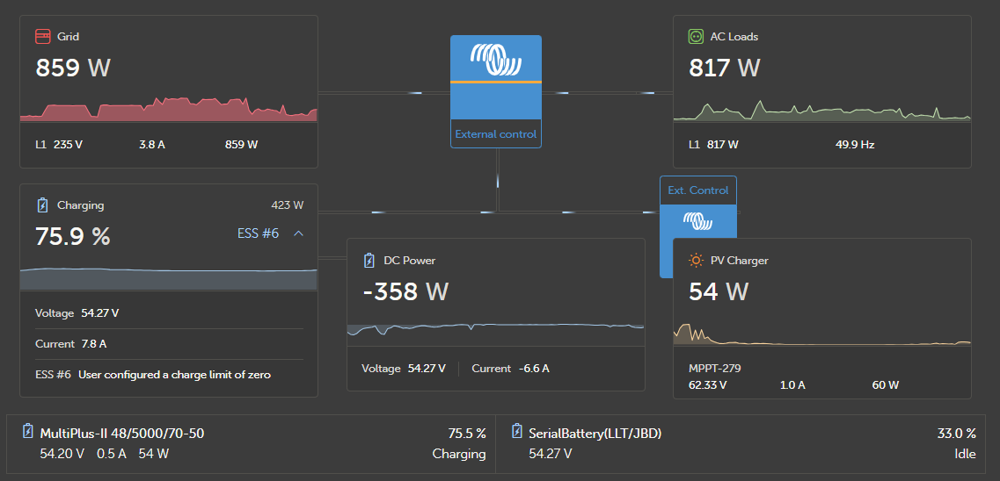
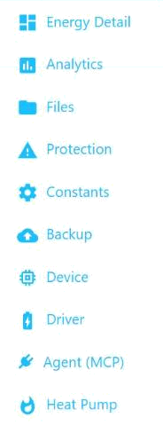
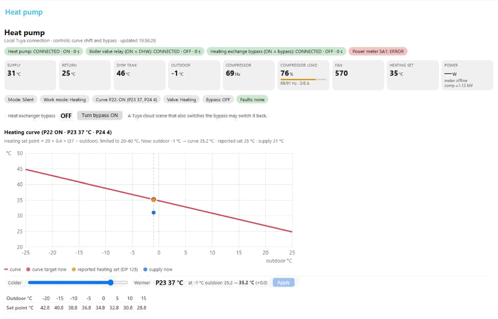
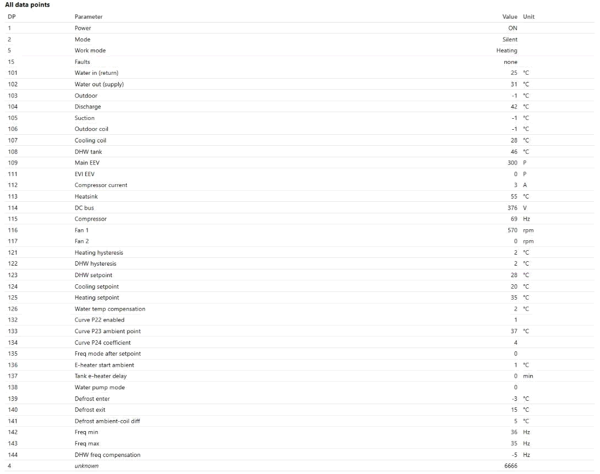
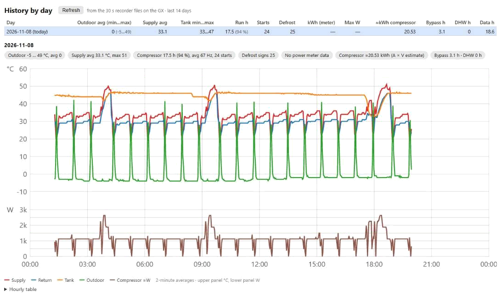

# Victron Cerbo GX hourly grid control for Norway

A Node-RED controller for a Victron ESS on a Cerbo GX (Venus OS) that keeps hourly grid import inside the Norwegian capacity tariff (*kapasitetsledd*) while still charging the battery when it makes sense.



## What it does

- BMS consumed-Ah restoration planning for night and morning charging
- dynamic ESS grid setpoint control
- DVCC charge current control based on the remaining battery Ah deficit
- capacity-tariff seasons: summer tier 1 (≤ 2 kW) / winter tier 2 (≤ 5 kW) with automatic switch dates, safe VE.Bus input current, daily kWh and month-tier tracking
- hourly imported-energy tracking from the house GRID CT sensor, monthly energy CSV history
- high-voltage protection when an external charger or MPPT raises battery voltage
- grid export guard: the battery absorbs surplus instead of exporting
- dashboards for energy, analytics, protection, constants, files, backup, device health and the battery driver
- BMS watchdog that restores DVCC "Controlling BMS" after it is lost
- an MCP server so an AI agent (e.g. Claude Code) can read the live state — at home or remotely over Tailscale
- notification logging when the grid setpoint changes
- [Heat Pump page](#heat-pump-page-tuya-wi-fi-heat-pump): local view of the Tuya Wi-Fi air-to-water heat pump, its DHW valve and bypass relays and its SA1 power meter, with compressor load, measured power, heating curve with a warmer / colder slider, a bypass switch, 24 h charts, a 30 s history on the GX and day-by-day statistics (no cloud, no Home Assistant); an [Automations](docs/heat-pump.md#automations-page-d123d126) page that runs all Smart Life heat pump scenes (B\* DHW cycles and modes, DF\* defrost, HP\*) on the GX with an internal defrost flag, behind a master switch and an Off / Test / On switch per rule, and an [Automation log](docs/heat-pump.md#automation-log-page-d126) page with every run by day

## Documentation

| Topic | What's inside |
|---|---|
| [Overview & architecture](docs/overview.md) | goal, signal flow, control layers |
| [Control logic](docs/control-logic.md) | charging windows, grid setpoint & tariff seasons, HV protection, day high load, solar forecast, energy counter & history files, force charging |
| [Grid tariffs in Norway](docs/tariffs-norway.md) | bill structure, *nettleie*, *kapasitetsledd*, why hourly peaks matter |
| [Dashboard](docs/dashboard.md) | every dashboard page with screenshots, Protection and Constants editors |
| [Device, battery driver & BMS watchdog](docs/device-driver.md) | Device status page, BMS watchdog, Driver page and logs |
| [Backup & restore](docs/backup-restore.md) | one-file backup of history and setup, restore on a new GX; energy and heating data archive by e-mail weekly and by a button |
| [Agent access (MCP)](docs/agent-mcp.md) | MCP server, Claude Code setup, `victron-status` skill, example answer; remote access in [Tailscale](#remote-access-tailscale) |
| [Development & deployment](docs/development.md) | repository layout, flow versioning, sync and deploy workflow |
| [Assumptions, limitations & roadmap](docs/limitations.md) | what the setup assumes, known limits, planned improvements |
| [Heat pump (Tuya, local)](docs/heat-pump.md) | devices, setup, Heat Pump page, DP map, roadmap to local control |
| [Boiler (DHW) control](docs/heat-pump-boiler.md) | what was done, how it changed and how the tank is heated now (d#142): curve settings, cycle, compressor protection, defrost, safety, settings |
| [DHW on the pump's curve](docs/heat-pump-dhw-curve-plan.md) | boiler cycle on the heat pump's own curve (d#142): current vs new design, boiler curve values, compressor protection |
| [Heat pump errors and e-mail alerts](docs/heat-pump.md#errors-log-events-red-marks-e-mail-alerts-d145) | pump faults as log events, red marks on the history chart, digest e-mails on errors (d#145) |
| [Heat pump work log](docs/heat-pump-work-log.md) | history of the move from Smart Life to the GX (d#123–d#153), owner requests, operating instructions |

## Dashboard pages



| Page | What it is for |
|---|---|
| Energy / Energy Detail | hourly grid / AC / solar energy, daily files |
| [Analytics](docs/dashboard.md#analytics-dashboard) | efficiency, PV routing, forecasts, capacity-tariff card |
| [Protection](docs/dashboard.md#protection-dashboard) | high-voltage limiter, Grid CT support, force charging, export guard |
| [Files](docs/dashboard.md#files--logs-and-disk-usage) | log files with sizes, disk used / free, file viewer |
| [Constants](docs/dashboard.md#controller-constants-dashboard) | controller constants incl. tariff seasons, tiers and grid current |
| [Backup](docs/backup-restore.md) | one-file backup / restore of history and the whole device setup |
| [Device](docs/device-driver.md#device-status-dashboard) | CPU, load, memory, disks, temperature, network, ports, processes, key services |
| [Driver](docs/device-driver.md#driver-dashboard) | dbus-serialbattery + BMS + MultiPlus health checks, BMS watchdog, logs |
| [Agent (MCP)](docs/agent-mcp.md) | MCP server for AI agents: endpoint, token, ready-to-paste client config |
| [Heat Pump](#heat-pump-page-tuya-wi-fi-heat-pump) | Tuya heat pump, valve, bypass and SA1 power meter: temperatures, power, compressor load, heating curve + warmer / colder slider, bypass switch, faults, all DPs, 30 s history, charts and statistics by day (local) |
| [Automations](docs/heat-pump.md#automations-page-d123d126) | local replacements for all Smart Life heat pump scenes (B\* DHW cycles and modes, DF\* defrost, HP\*) as timed sequences with an internal defrost flag: master switch for all local automations, per rule Off / Test / On and all at once, write check (d#123–d#126) |
| [Automation log](docs/heat-pump.md#automation-log-page-d126) | everything the local automations did, kept in a file per day: navigation by day, one entry per rule run with its steps and write results, filters (d#126). Which Smart Life scenes already run on the GX: [Migration log](docs/heat-pump.md#migration-log-smart-life--gx) |
| [Devices](docs/dashboard.md#devices--every-device-and-sensor-online) | every device of the Smart Life account (heat pump devices, sensors, smoke detectors, plugs, breakers, meters) read on the local network, and every Victron D-Bus device: online / offline, IP, last data, key values, battery (d#151–d#153) |
| [Air quality](docs/dashboard.md#air-quality--day-charts-of-the-qingping-air-monitor) | Qingping Air Monitor: CO2, PM2.5 / PM10, tVOC, temperature and humidity of one day from the day files on the GX, navigation by days (d#159) |
| Heat Pump data | every data point of the heat pump (DP, name, value, unit) and the raw SA1 meter data points, with a filter; moved from the Heat Pump page (d#164) |
| [Payback](docs/dashboard.md#payback--savings-and-payback-of-the-equipment) | savings since the energy history starts: peak shaving (capacity step), solar, battery night shift minus losses; equipment cost, what is left and the estimated payback; editable equipment list, prices and capacity steps (d#148) |

## Heat Pump page (Tuya Wi-Fi heat pump)

A dashboard tab for the Tuya-based air-to-water heat pump, its two Tuya relays (the boiler (DHW) valve and the heating-exchange bypass) and the **SA1 Wi-Fi Smart Power Transformer**, which measures the power of the whole heat pump. Node-RED talks to the devices **locally over the LAN** with the Tuya local protocol ([`node-red-contrib-tuya-smart-device`](https://flows.nodered.org/node/node-red-contrib-tuya-smart-device)). There is no Tuya cloud at runtime and no Home Assistant.

The page reads everything. Since d#121 it can also change **two things**, each only after a confirm dialog: the heating curve (a *colder / warmer* slider) and the bypass relay. All writes go through one node, `Heat pump command` ([`37`](37%20Heat%20pump%20command.js)). It checks the range and the connection and allows one write per device every 5 s. The valve relay and every other DP stay read only.



What the page shows, top to bottom:

- **Connection chips.** One per device: heat pump, boiler valve relay (ON = DHW), heating-exchange bypass (ON = bypass) and power meter SA1, with switch state and data age. Green = connected, yellow = connecting or stale, red = disconnected / error.
- **Key values in one row:** supply, return, DHW tank, outdoor, compressor frequency, **compressor load**, fan speed, heating set point and **power**. On a narrow screen the row scrolls sideways. The DHW set point is only in the table and the history.
- **Power** comes from the SA1 meter: W, with V and A below, plus the compressor estimate (`comp ≈ kW`). The meter is decoded automatically from one of two common Tuya layouts: plug-style DPs 18 / 19 / 20 (mA, W × 10, V × 10), or energy-meter DP 6 `phase_a` (base64 with V, A and W). If neither fits, the tile shows "—" and the raw meter DPs are listed at the bottom of the page.
- **Compressor load.** It uses both frequency and current against the compressor's rated maxima, **91 Hz** and **8 A**:
  - load % is the higher of Hz / 91 (DP 115) and A / 8 (DP 112), i.e. the limit the compressor is closest to;
  - the bar turns yellow from 60 % and red from 85 %;
  - the line below shows `Hz/91 · A/8`.

  The compressor estimate in the Power tile is compressor current (DP 112) × DC bus voltage (DP 114). There is no power DP in the heat pump, so this estimate is for trends only; the SA1 meter gives the real figure.

  Example: 76/91 Hz and 4/8 A give **84 %** and ≈ 1.50 kW.
- **Bypass switch.** It shows the state of the heat exchanger bypass and a *Turn bypass ON / OFF* button (with a confirm dialog). It sends `DP 1 = true / false` to the `Off Heating exchange` relay. If a Tuya cloud scene also switches the bypass, the scene may switch it back.
- **Status chips:** mode (e.g. Silent), work mode (Heating / DHW / Cooling), curve P22 with P23 / P24, valve and bypass state, and decoded faults (`Er03` … `Er70`, or *none*). A defrost sign appears when the fan is at 0 while the compressor runs above 30 Hz.
- **Heating curve.** This is the controller's built-in weather curve (P22 on), drawn for outdoor −25…+25 °C:

  **heating set point = 20 + (P24 / 10) × (P23 − outdoor)**, limited to 20–60 °C.

  A dashed line marks the current outdoor temperature. On it: the curve target (red), the set point the pump reports, DP 125 (yellow), and the actual supply (blue). Below the chart is a table for −20…+15 °C. With P23 = 37 and P24 = 4 (P23 was raised from 32 on 8 Nov 2026, i.e. +2 °C everywhere):

  | Outdoor °C | −20 | −15 | −10 | −5 | 0 | 5 | 10 | 15 |
  |---|---|---|---|---|---|---|---|---|
  | Set point °C | 42.8 | 40.8 | 38.8 | 36.8 | 34.8 | 32.8 | 30.8 | 28.8 |

  In the screenshot (outdoor −1 °C) the curve gives 35.2 °C and the pump reports 35 °C. Earlier, with P23 = 32 at −3 °C, the curve gave 34 °C against a reported 35 °C. So the formula is close, but the manual does not confirm it.

  **Colder / warmer slider.** Below the chart there is a slider for **P23** (DP 133), limited to 20…40 °C. P23 shifts the whole curve. Each +1 °C of P23 raises the set point by P24 / 10 °C at every outdoor temperature, so with P24 = 4 that is +0.4 °C. While you drag, the page shows the new curve as a blue dashed line, and the set point at the current outdoor temperature before and after (e.g. `35.6 → 36.4 °C (+0.8)`). **Apply** asks for confirmation, then sends `DP 133 = <value>` to the heat pump. **Reset** discards the change. The slope (P24) and P22 are not changed.
- **All data points:** every DP the heat pump reports, with name, value and unit. Unknown DPs are listed separately.



Example reading (8 Nov 2026, 00:57; outdoor −3 °C; Heating, Silent):

| Group | Values |
|---|---|
| Water | supply 33 °C, return 29 °C, DHW tank 45 °C |
| Refrigerant | discharge 32 °C, suction −6 °C, outdoor coil −6 °C, cooling coil 29 °C, main EEV 190 P, EVI EEV 0 P |
| Compressor / drive | 69 Hz, 3 A, DC bus 376 V, heatsink 55 °C, fan 1 608 rpm, fan 2 0 rpm |
| Settings | heating set 35 °C, DHW set 28 °C, cooling set 20 °C, heating / DHW hysteresis 2 / 2 °C, water temp compensation 2 °C, curve P22 on, P23 32 °C, P24 4 |

- **History by day.** This is a table of the last 14 days, read from the history files below:
  - outdoor average (min…max), supply average, tank min…max;
  - compressor run hours (% of the time), starts and defrost signs;
  - **kWh measured by the meter** and max W, plus the compressor ≈kWh estimate;
  - bypass and DHW hours, and hours with data.

  Switch days with ‹ › or the day chips (or click a row). Each day has a temperature chart with the event lane under it (heating / DHW / defrost) and a separate power chart: compressor W = DC bus voltage × compressor current, the SA1 meter W when it is reachable, and the compressor current in A (dashed, right axis, d#141); while a DHW cycle runs, today's chart shows dashed lines to the tank target and the expected end (d#143) and refreshes every minute; all as 2-minute averages. The legends sit above the charts; click a name to hide or show that series (remembered in the browser). Point at a chart (or tap it) to see a cursor line, a dot per series and a tooltip with the time, the event (heating / dhw / defrost) and every visible value (d#136). The 24 h charts *Temperatures* and *Power* were removed in d#135: the same data is here by day. It also has a collapsible hourly table (outdoor, supply, compressor minutes, kWh). Finished days are cached in memory, so the summary only re-reads today. The page only reads files.
- **History on the GX (all data points, every 30 s).** One file per hour: `/data/home/nodered/grid-control-logs/heatpump/YYYY-MM-DD/HH.csv`. When the hour changes, finished hours are gzipped to `HH.csv.gz`. The format "hp1" is a delta CSV:

  ```
  #hp1 2026-11-08 00 cols=t,st,1,2,5,15,101,102,103,...,144,b1
  5,CEC,1,mute,heat,0,29,33,-3,32,-6,-6,29,45,190,0,3,55,376,68,582,...   ← keyframe: every column
  35,,,,,,,,,,,,,,,,,,,70,595                                              ← only what changed
  65,,,,,,30,,,,,,,,181,,,,,71
  ```

  - `t` = second of the hour.
  - `st` = state of the heat pump / valve / bypass / power meter: **C**onnected, co**N**necting, **D**isconnected, **E**rror, **U**nknown, **S**tale. Files from before d#121 have three letters.
  - Columns are DP ids; `v…` / `b…` / `m…` are the valve, bypass and power meter DPs; `pw` is the decoded heat pump power in W.
  - An empty field means unchanged, and trailing empty fields are dropped.
  - A new header plus keyframe is written each hour, after a restart and when a new DP appears.

  Size: about **4 KB per hour plain and 1 KB gzipped**, roughly 25–50 KB per day and 10–20 MB per year.

  To get full rows back: `node tools/heatpump-decode.js [--names] 00.csv.gz 01.csv.gz > day.csv`.

In the temperature chart, the short dips in supply and return about once an hour are most likely **defrost cycles**. At the same moments the outdoor reading jumps to 40–50 °C, most likely because the outdoor sensor sits on the outdoor unit and is warmed during defrost. Treat outdoor values during these spikes as invalid.

Until the SA1 meter is reachable from the GX (see [docs/heat-pump.md](docs/heat-pump.md#devices)) only the compressor power is drawn.



How it works:

1. `Poll heat pump (GET, read only)` sends `{"operation":"GET","schema":true}` to the four Tuya nodes every 30 s. The `operation` is always set explicitly, because the Tuya node treats a message without it as `SET`.
2. `Heat pump state` ([`34 Heat pump state.js`](34%20Heat%20pump%20state.js)) merges the DPs into `flow.heatPump` (raw) and `flow.heatPumpModel` (page model). It also decodes the meter and computes the compressor load and the heating-curve chart.
3. `Heat pump page` (ui_template, [`35 Heat pump page.html`](35%20Heat%20pump%20page.html)) and the `Heat pump temperatures` / `Heat pump power` charts render it.
4. `Heat pump log tick (30 s)` → `Record heat pump data` ([`36 Record heat pump data.js`](36%20Record%20heat%20pump%20data.js)) → `Append heat pump data` (file node) writes the hourly file, and `Compress heat pump hours` (exec, `gzip`) packs the finished hours. The decoder is [`tools/heatpump-decode.js`](tools/heatpump-decode.js).
5. The page buttons and the history page send requests to `Heat pump command` ([`37 Heat pump command.js`](37%20Heat%20pump%20command.js)):
   - `curve` → `SET` DP 133 on *Heating pump*;
   - `bypass` → `SET` DP 1 on *Off Heating exchange*;
   - `summary` / `day` → the exec node `Read heat pump history`, which runs `gzip -dc` / `cat` over the day folders.

   Every request is validated: a date must be `YYYY-MM-DD`, P23 must be an integer 20…40, the bypass value must be a boolean, and the target device must be connected with data no older than 5 min.
6. `Build heat pump history` ([`38 Build heat pump history.js`](38%20Build%20heat%20pump%20history.js)) turns the files into statistics and the day chart. `Heat pump history` (ui_template, [`39 Heat pump history page.html`](39%20Heat%20pump%20history%20page.html)) shows them.

Setup: install the palette node, then enter the **Device ID, Local Key, IP and protocol version** in the four Tuya nodes yourself (see [Secrets](#secrets)). Set the IP explicitly: without it the node relies on UDP discovery, which can fail (`find() timed out`). Some devices never send discovery beacons — here the boiler valve relay (protocol **3.5**) — so for them the IP is required. If you do not know the IP, take the MAC from Smart Life Web (Device Details) and look it up in the router's client list or the GX ARP table (`ip neigh`). Device list, DP map and the roadmap to local control are in [docs/heat-pump.md](docs/heat-pump.md).

> **Keep the Tuya keys when you update the flow.** The keys are stored as Node-RED credentials, not in `flows.json`. *Import → Replace* swaps in Tuya nodes without keys, and the next Deploy overwrites the stored keys with empty values. The same happens if you open such a node and press *Done*. When importing, use **View nodes…** in the import dialog and untick the Tuya nodes that are already set up (*Heating pump*, *Boiler valve relay*, *Off Heating exchange*, and *SA1 power meter (heat pump)* once it has keys), so the deployed ones are kept. The first time you import d#121, keep *SA1 power meter (heat pump)* ticked, because it is new, then enter its keys.

## Quick start

1. Cerbo GX with Venus OS Large, Node-RED enabled, ESS configured, GRID CT and the battery visible on D-Bus ([assumptions](docs/limitations.md)).
2. Make a backup on the **Backup** page, then install the palette node `node-red-contrib-tuya-smart-device` (Heat Pump page), import `flows.json` into Node-RED (Replace) and deploy. Adjust the Victron nodes to your devices, and enter the Tuya Device ID / Local Key / IP in the four Tuya nodes yourself. On later updates do not replace the Tuya nodes ([why](#heat-pump-page-tuya-wi-fi-heat-pump)) ([heat pump](docs/heat-pump.md#setup), [secrets](#secrets)).
3. Set the tariff season, tiers and limits on the dashboard **Constants** page ([control logic](docs/control-logic.md#tariff-seasons-summer--winter)).
4. When editing logic: change the numbered `NN *.js` source (or `35 Heat pump page.html` for the Heat Pump page), then sync it into `flows.json` with `node tools/flows.js sync` (or `Sync-All` / `Sync-NN` from `sync-commands.ps1`). A sync that changes `flows.json` bumps the tab label `d#<n>`. Before a deploy run `node tools/flows.js check` and `node --test "tests/*.test.js"` ([development](docs/development.md)).
5. Optional: set up remote access over [Tailscale](#remote-access-tailscale) for the dashboard, SSH and the MCP server away from home.

## Remote access (Tailscale)

Venus OS v3.67 has no built-in Tailscale. Use the third-party package **TailscaleGX** ([kwindrem/TailscaleGX](https://github.com/kwindrem/TailscaleGX)), installed as root over SSH:

1. Install [SetupHelper](https://github.com/kwindrem/SetupHelper), then TailscaleGX (Package manager in the GUI, or `setup install auto` in the package folder over SSH).
2. Enable it in the menu TailscaleGX adds to the GUI, or with the D-Bus setting `/Settings/Services/Tailscale/Enabled = 1`.
3. Run `/data/TailscaleGX/authorizeTailscale`, open the printed link and log in with your Tailscale account.
4. In the Tailscale admin console, disable key expiry for the GX.
5. Install Tailscale on your PC. The GX is then reachable on its `100.x.y.z` address:
   - dashboard: `https://100.x.y.z:1881/ui`;
   - SSH: `ssh root@100.x.y.z`;
   - MCP: `https://100.x.y.z:1881/mcp` with `--insecure` (the self-signed cert is for `venus.local` and has no IP SAN).

The VRM remote-console relay does not work for MCP clients (it returns 403 "No session"), so use Tailscale or the LAN.

## Secrets

Nothing secret is stored in this repository. Keep it that way:

| Secret | Where it comes from | Where it is kept |
|---|---|---|
| Tuya Local Key ×3 | Tuya IoT Platform cloud project linked to the Smart Life app. Get it with `python -m tinytuya wizard` or API Explorer → *Query Device Details* (`local_key`) | entered by hand in the Tuya nodes. `storeAsCreds: true` keeps it in the encrypted `flows_cred.json`, not in `flows.json`. Local notes go in the git-ignored `.secrets/` folder |
| Tuya IoT Access ID / Secret | Tuya IoT Platform → project → Overview | `.secrets/` (git-ignored) |
| MCP token | generated on the GX: `/data/home/nodered/grid-control-config/mcp-token.txt`, shown on the **Agent (MCP)** page | GX only. Pass it to the client as `MCP_TOKEN` (an agent with SSH access can read it straight into the env var). Regenerate it if it was ever pasted into a chat |
| GX root password / SSH key | Remote Console → Settings → General; `ssh-keygen` on the PC, public key in `/root/.ssh/authorized_keys` | your password manager / `~/.ssh` |

The Local Key changes if a Tuya device is reset or re-paired; fetch it again then. `.gitignore` also excludes local handoff notes (`HANDOFF.md`) and the agent channel (`.claude/bridge/`).

## Summary

This repository is a practical Victron + Node-RED implementation for Norwegian hourly peak control. It combines time-window charging, solar-forecast-aware current reduction, voltage hysteresis, hourly imported-energy counting, dynamic power limiting and Norway-oriented tariff thinking — a controller that is meant to be understandable, editable and directly useful on a Cerbo GX based ESS installation.

## License

[MIT](LICENSE) — free to use, change and share, also commercially. Just keep the credit: **Vadym Zakusylo** and a link to this repository, https://github.com/vzakusylo/victron 🙂

The software is provided as is, without warranty. It controls an inverter, grid import and battery charging — check every setting against your own equipment and local electrical rules, and use it at your own risk.
