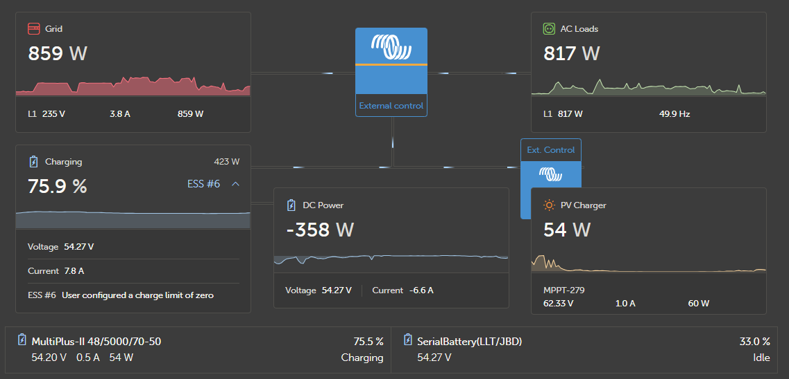
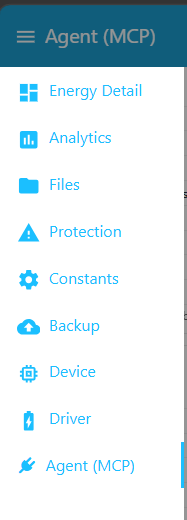

# Victron Cerbo GX hourly grid control for Norway

A Node-RED controller for a Victron ESS on a Cerbo GX (Venus OS) that keeps hourly grid import inside the Norwegian capacity tariff (*kapasitetsledd*) while still charging the battery when it makes sense.

## What it does

- BMS consumed-Ah restoration planning for night and morning charging
- dynamic ESS grid setpoint control
- DVCC charge current control based on the remaining battery Ah deficit
- capacity-tariff seasons: summer tier 1 (≤ 2 kW) / winter tier 2 (≤ 5 kW) with automatic switch dates, safe VE.Bus input current, daily kWh and month-tier tracking
- hourly imported-energy tracking from the house GRID CT sensor, monthly energy CSV history
- high-voltage protection when an external charger or MPPT raises battery voltage
- grid export guard: the battery absorbs surplus instead of exporting
- dashboards for energy, analytics, protection, constants, files, backup, device health and the battery driver
- BMS watchdog that restores DVCC "Controlling BMS" after it is lost
- an MCP server so an AI agent (e.g. Claude Code) can read the live state
- notification logging when the grid setpoint changes

## Documentation

| Topic | What's inside |
|---|---|
| [Overview & architecture](docs/overview.md) | goal, signal flow, control layers |
| [Control logic](docs/control-logic.md) | charging windows, grid setpoint & tariff seasons, HV protection, heavy load, solar forecast, energy counter & history files, force charging |
| [Grid tariffs in Norway](docs/tariffs-norway.md) | bill structure, *nettleie*, *kapasitetsledd*, why hourly peaks matter |
| [Dashboard](docs/dashboard.md) | every dashboard page with screenshots, Protection and Constants editors |
| [Device, battery driver & BMS watchdog](docs/device-driver.md) | Device status page, BMS watchdog, Driver page and logs |
| [Backup & restore](docs/backup-restore.md) | one-file backup of history and setup, restore on a new GX |
| [Agent access (MCP)](docs/agent-mcp.md) | MCP server, Claude Code setup, `victron-status` skill, example answer |
| [Development & deployment](docs/development.md) | repository layout, flow versioning, sync and deploy workflow |
| [Assumptions, limitations & roadmap](docs/limitations.md) | what the setup assumes, known limits, planned improvements |

## Dashboard pages

| Page | What it is for |
|---|---|
| Energy / Energy Detail | hourly grid / AC / solar energy, daily files |
| [Analytics](docs/dashboard.md#analytics-dashboard) | efficiency, PV routing, forecasts, capacity-tariff card |
| [Protection](docs/dashboard.md#protection-dashboard) | high-voltage limiter, Grid CT support, force charging, export guard |
| [Files](docs/dashboard.md#files--logs-and-disk-usage) | log files with sizes, disk used / free, file viewer |
| [Constants](docs/dashboard.md#controller-constants-dashboard) | controller constants incl. tariff seasons, tiers and grid current |
| [Backup](docs/backup-restore.md) | one-file backup / restore of history and the whole device setup |
| [Device](docs/device-driver.md#device-status-dashboard) | CPU, load, memory, disks, temperature, network, ports, processes, key services |
| [Driver](docs/device-driver.md#driver-dashboard) | dbus-serialbattery + BMS + MultiPlus health checks, BMS watchdog, logs |
| [Agent (MCP)](docs/agent-mcp.md) | MCP server for AI agents: endpoint, token, ready-to-paste client config |

## Quick start

1. Cerbo GX with Venus OS Large, Node-RED enabled, ESS configured, GRID CT and the battery visible on D-Bus ([assumptions](docs/limitations.md)).
2. Import `flows.json` into Node-RED and deploy; adjust the Victron nodes to your devices.
3. Set the tariff season, tiers and limits on the dashboard **Constants** page ([control logic](docs/control-logic.md#tariff-seasons-summer--winter)).
4. When editing logic: change the numbered `NN *.js` source, then sync it into `flows.json` with `sync-commands.ps1` ([development](docs/development.md)).

## Summary

This repository is a practical Victron + Node-RED implementation for Norwegian hourly peak control. It combines time-window charging, solar-forecast-aware current reduction, voltage hysteresis, hourly imported-energy counting, dynamic power limiting and Norway-oriented tariff thinking — a controller that is meant to be understandable, editable and directly useful on a Cerbo GX based ESS installation.

## License

[MIT](LICENSE) — free to use, change and share, also commercially. Just keep the credit: **Vadym Zakusylo** and a link to this repository, https://github.com/vzakusylo/victron 🙂

The software is provided as is, without warranty. It controls an inverter, grid import and battery charging — check every setting against your own equipment and local electrical rules, and use it at your own risk.
