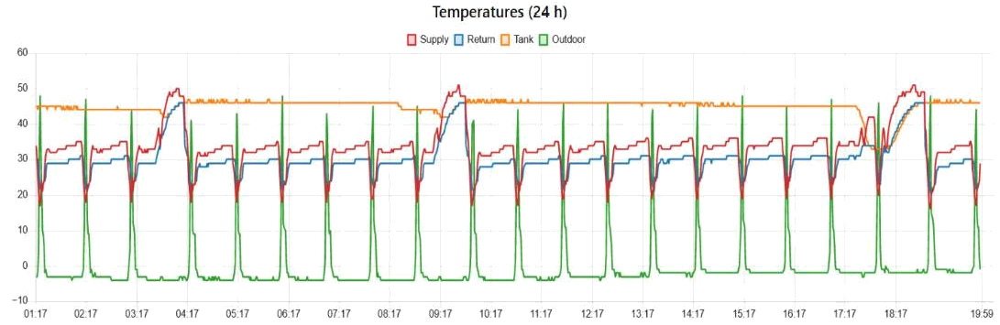

# Victron Cerbo GX hourly grid control for Norway

A Node-RED controller for a Victron ESS on a Cerbo GX (Venus OS) that keeps hourly grid import inside the Norwegian capacity tariff (*kapasitetsledd*) while still charging the battery when it makes sense.

## What it does

- BMS consumed-Ah restoration planning for night and morning charging
- dynamic ESS grid setpoint control
- DVCC charge current control based on the remaining battery Ah deficit
- capacity-tariff seasons: summer tier 1 (≤ 2 kW) / winter tier 2 (≤ 5 kW) with automatic switch dates, safe VE.Bus input current, daily kWh and month-tier tracking
- hourly imported-energy tracking from the house GRID CT sensor, monthly energy CSV history
- high-voltage protection when an external charger or MPPT raises battery voltage
- grid export guard: the battery absorbs surplus instead of exporting
- dashboards for energy, analytics, protection, constants, files, backup, device health and the battery driver
- BMS watchdog that restores DVCC "Controlling BMS" after it is lost
- an MCP server so an AI agent (e.g. Claude Code) can read the live state — at home or remotely over Tailscale
- notification logging when the grid setpoint changes
- [Heat Pump page](#heat-pump-page-tuya-wi-fi-heat-pump-read-only): local read-only view of the Tuya Wi-Fi air-to-water heat pump, its DHW valve and bypass relays, with a 24 h temperature chart (no cloud, no Home Assistant)

## Documentation

| Topic | What's inside |
|---|---|
| [Overview & architecture](docs/overview.md) | goal, signal flow, control layers |
| [Control logic](docs/control-logic.md) | charging windows, grid setpoint & tariff seasons, HV protection, heavy load, solar forecast, energy counter & history files, force charging |
| [Grid tariffs in Norway](docs/tariffs-norway.md) | bill structure, *nettleie*, *kapasitetsledd*, why hourly peaks matter |
| [Dashboard](docs/dashboard.md) | every dashboard page with screenshots, Protection and Constants editors |
| [Device, battery driver & BMS watchdog](docs/device-driver.md) | Device status page, BMS watchdog, Driver page and logs |
| [Backup & restore](docs/backup-restore.md) | one-file backup of history and setup, restore on a new GX |
| [Agent access (MCP)](docs/agent-mcp.md) | MCP server, Claude Code setup, `victron-status` skill, example answer; remote access in [Tailscale](#remote-access-tailscale) |
| [Development & deployment](docs/development.md) | repository layout, flow versioning, sync and deploy workflow |
| [Assumptions, limitations & roadmap](docs/limitations.md) | what the setup assumes, known limits, planned improvements |
| [Heat pump (Tuya, local)](docs/heat-pump.md) | devices, setup, Heat Pump page, DP map, roadmap to local control |

## Dashboard pages

| Page | What it is for |
|---|---|
| Energy / Energy Detail | hourly grid / AC / solar energy, daily files |
| [Analytics](docs/dashboard.md#analytics-dashboard) | efficiency, PV routing, forecasts, capacity-tariff card |
| [Protection](docs/dashboard.md#protection-dashboard) | high-voltage limiter, Grid CT support, force charging, export guard |
| [Files](docs/dashboard.md#files--logs-and-disk-usage) | log files with sizes, disk used / free, file viewer |
| [Constants](docs/dashboard.md#controller-constants-dashboard) | controller constants incl. tariff seasons, tiers and grid current |
| [Backup](docs/backup-restore.md) | one-file backup / restore of history and the whole device setup |
| [Device](docs/device-driver.md#device-status-dashboard) | CPU, load, memory, disks, temperature, network, ports, processes, key services |
| [Driver](docs/device-driver.md#driver-dashboard) | dbus-serialbattery + BMS + MultiPlus health checks, BMS watchdog, logs |
| [Agent (MCP)](docs/agent-mcp.md) | MCP server for AI agents: endpoint, token, ready-to-paste client config |
| [Heat Pump](#heat-pump-page-tuya-wi-fi-heat-pump-read-only) | Tuya heat pump, valve and bypass: temperatures, compressor, faults, all DPs, 24 h chart (read only, local) |

## Heat Pump page (Tuya Wi-Fi heat pump, read only)

A dashboard tab for the Tuya-based air-to-water heat pump and its two Tuya relays: the boiler (DHW) valve and the heating-exchange bypass. Node-RED talks to the devices **locally over the LAN** with the Tuya local protocol ([`node-red-contrib-tuya-smart-device`](https://flows.nodered.org/node/node-red-contrib-tuya-smart-device)). There is no Tuya cloud at runtime and no Home Assistant. Stage 1 is **read only**: the flow only sends `GET`, never `SET`.

What the page shows:

- **Connection state** of each device: heat pump, boiler valve relay (ON = DHW) and heating-exchange bypass (ON = bypass), with power state and data age.
- **Key values:** supply, return, DHW tank and outdoor temperature; compressor frequency (Hz); fan speed; heating and DHW set points.
- **Status chips:** mode (e.g. Silent), work mode (Heating / DHW / Cooling), heating curve P22 with P23 / P24, valve and bypass state, and decoded faults (`Er03` … `Er70`, or *none*). A defrost sign is shown when the fan is at 0 while the compressor runs above 30 Hz.
- **All data points:** a table of every DP the heat pump reports, with name, value and unit. For example: power, mode, work mode, faults, water in / out, outdoor, discharge, suction, outdoor and cooling coil, DHW tank, main and EVI EEV steps, compressor current, heatsink and DC bus voltage. Unknown DPs are listed separately.
- **Temperatures (24 h):** a chart of supply, return, tank and outdoor, one point per minute.

In the chart, the short dips in supply and return about once an hour are most likely **defrost cycles**. At the same moments the outdoor reading jumps to 40–50 °C, most likely because the outdoor sensor sits on the outdoor unit and is warmed during defrost. Treat outdoor values during these spikes as invalid.

How it works:

1. `Poll heat pump (GET, read only)` sends `{"operation":"GET","schema":true}` to the three Tuya nodes every 60 s. The `operation` is always set explicitly, because the Tuya node treats a message without it as `SET`.
2. `Heat pump state` ([`34 Heat pump state.js`](34%20Heat%20pump%20state.js)) merges the DPs into `flow.heatPump` (raw) and `flow.heatPumpModel` (page model).
3. `Heat pump page` (ui_template, [`35 Heat pump page.html`](35%20Heat%20pump%20page.html)) and the `Heat pump temperatures` chart render it.

Setup: install the palette node, then enter the **Device ID, Local Key, IP and protocol version** in the three Tuya nodes yourself (see [Secrets](#secrets)). Device list, DP map and the roadmap to local control are in [docs/heat-pump.md](docs/heat-pump.md).

## Quick start

1. Cerbo GX with Venus OS Large, Node-RED enabled, ESS configured, GRID CT and the battery visible on D-Bus ([assumptions](docs/limitations.md)).
2. Make a backup on the **Backup** page, then install the palette node `node-red-contrib-tuya-smart-device` (Heat Pump page), import `flows.json` into Node-RED (Replace) and deploy. Adjust the Victron nodes to your devices, and enter the Tuya Device ID / Local Key in the three Tuya nodes yourself ([heat pump](docs/heat-pump.md#setup), [secrets](#secrets)).
3. Set the tariff season, tiers and limits on the dashboard **Constants** page ([control logic](docs/control-logic.md#tariff-seasons-summer--winter)).
4. When editing logic: change the numbered `NN *.js` source (or `35 Heat pump page.html` for the Heat Pump page), then sync it into `flows.json` with `sync-commands.ps1`. `Sync-NN` syncs one node; `Sync-All` syncs all function nodes and the Heat Pump `ui_template`. Every sync bumps the tab label `d#<n>` ([development](docs/development.md)).
5. Optional: set up remote access over [Tailscale](#remote-access-tailscale) for the dashboard, SSH and the MCP server away from home.

## Remote access (Tailscale)

Venus OS v3.67 has no built-in Tailscale. Use the third-party package **TailscaleGX** ([kwindrem/TailscaleGX](https://github.com/kwindrem/TailscaleGX)), installed as root over SSH:

1. Install [SetupHelper](https://github.com/kwindrem/SetupHelper), then TailscaleGX (Package manager in the GUI, or `setup install auto` in the package folder over SSH).
2. Enable it in the menu TailscaleGX adds to the GUI, or with the D-Bus setting `/Settings/Services/Tailscale/Enabled = 1`.
3. Run `/data/TailscaleGX/authorizeTailscale`, open the printed link and log in with your Tailscale account.
4. In the Tailscale admin console, disable key expiry for the GX.
5. Install Tailscale on your PC. The GX is then reachable on its `100.x.y.z` address:
   - dashboard: `https://100.x.y.z:1881/ui`;
   - SSH: `ssh root@100.x.y.z`;
   - MCP: `https://100.x.y.z:1881/mcp` with `--insecure` (the self-signed cert is for `venus.local` and has no IP SAN).

The VRM remote-console relay does not work for MCP clients (it returns 403 "No session"), so use Tailscale or the LAN.

## Secrets

Nothing secret is stored in this repository. Keep it that way:

| Secret | Where it comes from | Where it is kept |
|---|---|---|
| Tuya Local Key ×3 | Tuya IoT Platform cloud project linked to the Smart Life app. Get it with `python -m tinytuya wizard` or API Explorer → *Query Device Details* (`local_key`) | entered by hand in the Tuya nodes. `storeAsCreds: true` keeps it in the encrypted `flows_cred.json`, not in `flows.json`. Local notes go in the git-ignored `.secrets/` folder |
| Tuya IoT Access ID / Secret | Tuya IoT Platform → project → Overview | `.secrets/` (git-ignored) |
| MCP token | generated on the GX: `/data/home/nodered/grid-control-config/mcp-token.txt`, shown on the **Agent (MCP)** page | GX only. Pass it to the client as `MCP_TOKEN` (an agent with SSH access can read it straight into the env var). Regenerate it if it was ever pasted into a chat |
| GX root password / SSH key | Remote Console → Settings → General; `ssh-keygen` on the PC, public key in `/root/.ssh/authorized_keys` | your password manager / `~/.ssh` |

The Local Key changes if a Tuya device is reset or re-paired; fetch it again then. `.gitignore` also excludes local handoff notes (`HANDOFF.md`) and the agent channel (`.claude/bridge/`).

## Summary

This repository is a practical Victron + Node-RED implementation for Norwegian hourly peak control. It combines time-window charging, solar-forecast-aware current reduction, voltage hysteresis, hourly imported-energy counting, dynamic power limiting and Norway-oriented tariff thinking — a controller that is meant to be understandable, editable and directly useful on a Cerbo GX based ESS installation.

## License

[MIT](LICENSE) — free to use, change and share, also commercially. Just keep the credit: **Vadym Zakusylo** and a link to this repository, https://github.com/vzakusylo/victron 🙂

The software is provided as is, without warranty. It controls an inverter, grid import and battery charging — check every setting against your own equipment and local electrical rules, and use it at your own risk.
