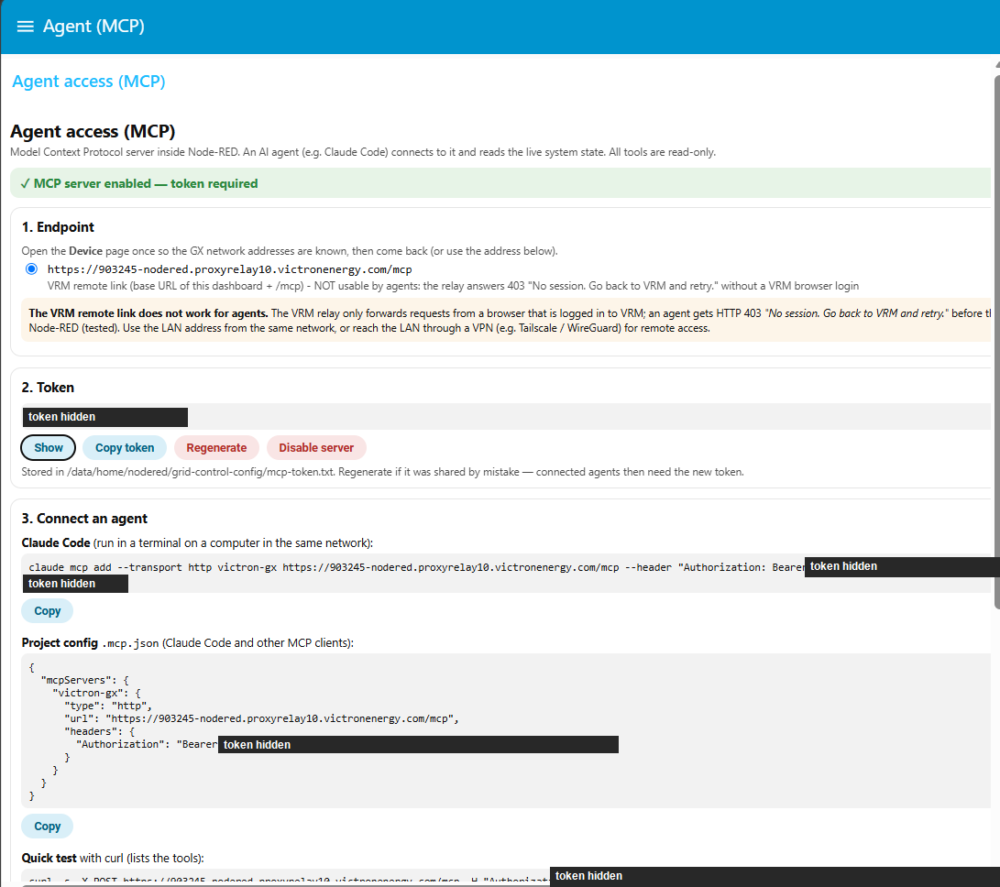
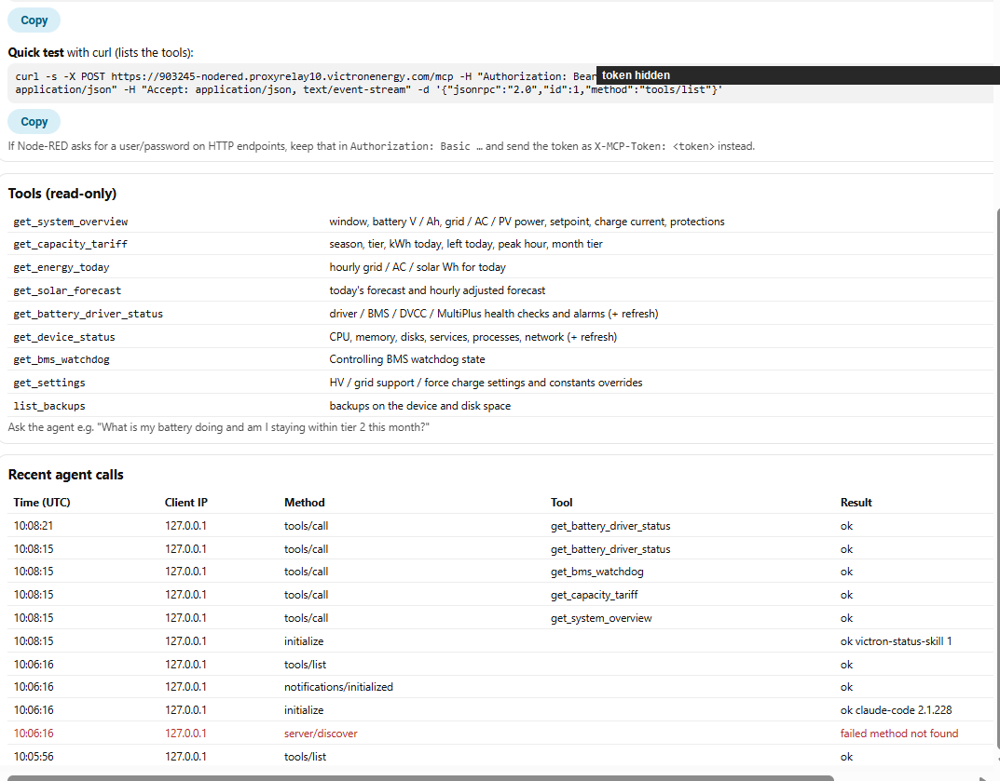
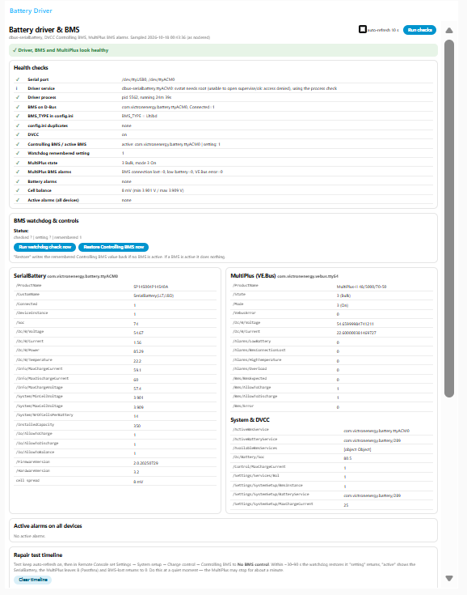
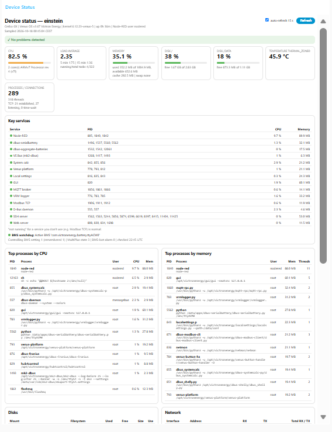
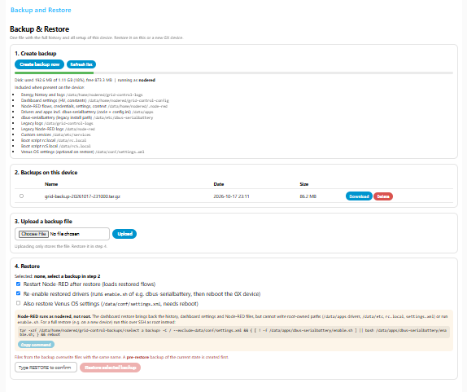
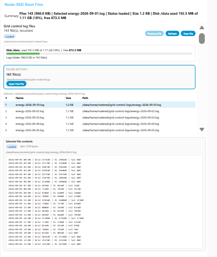
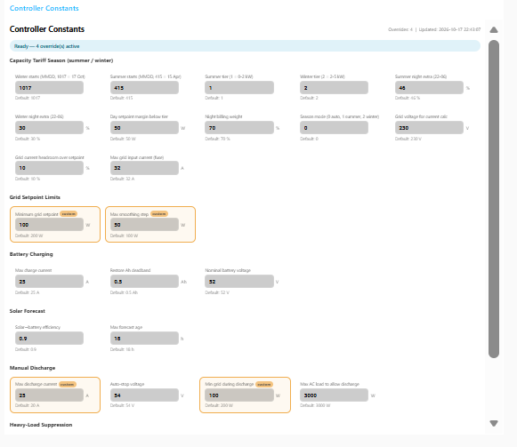
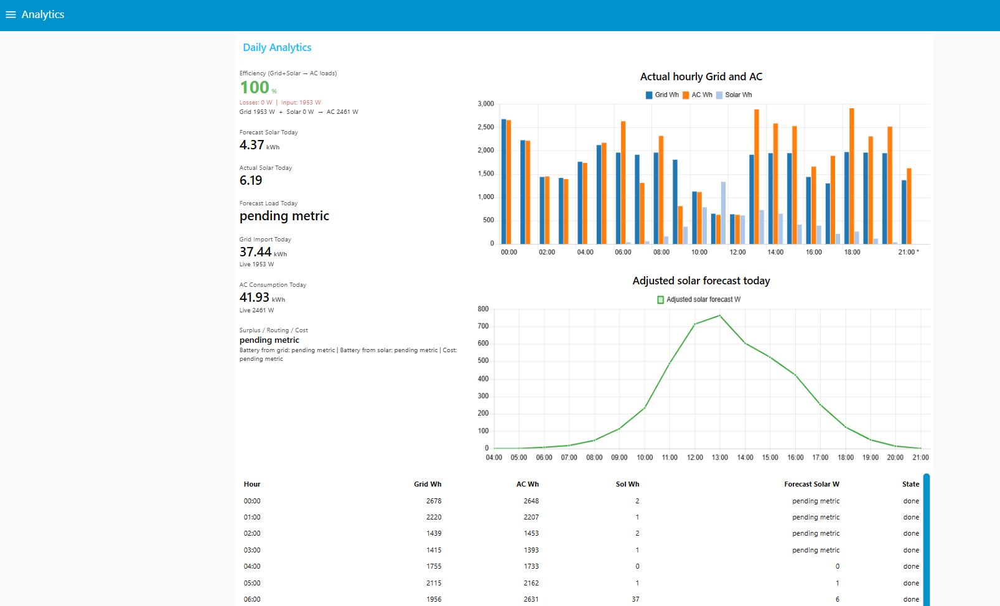
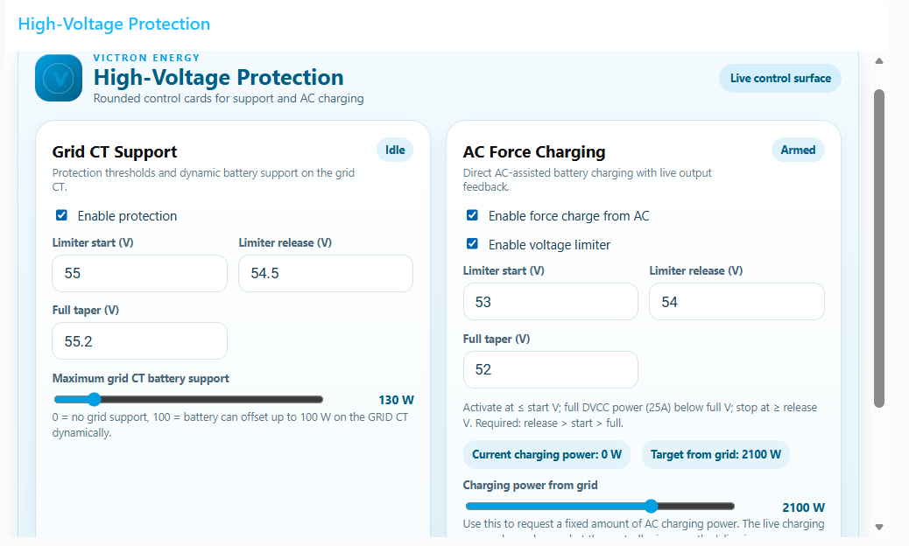

[Home](../README.md) · [Overview](overview.md) · [Control logic](control-logic.md) · [Tariffs](tariffs-norway.md) · **Dashboard** · [Device & driver](device-driver.md) · [Backup](backup-restore.md) · [Agent (MCP)](agent-mcp.md) · [Development](development.md) · [Limitations](limitations.md)

# Dashboard

> All dashboard pages with screenshots, Protection and Constants editors, persistence, data path

**On this page:**

- [Dashboard pages](#dashboard-pages)
  - [Agent (MCP) — connect an AI agent](#agent-mcp--connect-an-ai-agent)
  - [Driver — battery driver, BMS and MultiPlus health](#driver--battery-driver-bms-and-multiplus-health)
  - [Device — GX device health](#device--gx-device-health)
  - [Backup — backup and restore of the whole setup](#backup--backup-and-restore-of-the-whole-setup)
  - [Files — logs and disk usage](#files--logs-and-disk-usage)
  - [Constants — controller constants and tariff seasons](#constants--controller-constants-and-tariff-seasons)
  - [Analytics dashboard](#analytics-dashboard)
- [Protection dashboard](#protection-dashboard)
  - [Grid CT Support card](#grid-ct-support-card)
  - [AC Force Charging card](#ac-force-charging-card)
- [Save and persistence behavior](#save-and-persistence-behavior)
- [Dashboard data path](#dashboard-data-path)
- [Controller Constants dashboard](#controller-constants-dashboard)

The live flow now includes several dashboard surfaces for operation and diagnostics, including a dedicated `Protection` tab for runtime control of the high-voltage limiter and AC-assisted charging.

## Dashboard pages

### Agent (MCP) — connect an AI agent

Enables the built-in MCP server (`POST /mcp`) and shows everything needed to connect an agent: endpoint, token (show / copy / regenerate / disable), copy-ready `claude mcp add …`, `.mcp.json` and curl commands, the nine read-only tools and a log of the latest agent calls (the screenshot shows Claude Code 2.1.228 and the `victron-status` skill connecting). Use `https://venus.local:1881/mcp` from the home network — the GX certificate is issued to `venus.local`; the VRM remote link answers 403 "No session" to anything but a logged-in browser. In the screenshots the token is blacked out. See [Agent access (MCP)](agent-mcp.md).

### Driver — battery driver, BMS and MultiPlus health

One page with every check used to diagnose the battery chain: serial port, driver process, BMS on D-Bus, `BMS_TYPE`, DVCC, Controlling BMS / active BMS, MultiPlus state and BMS alarms, cell balance and all active alarms — each marked ✓ / ⚠ / ✗. Below: live SerialBattery / MultiPlus / DVCC values, the BMS watchdog with `Run watchdog check now` and `Restore Controlling BMS now`, a repair-test timeline, the driver log viewer and copyable root-only SSH commands. See [Driver page](device-driver.md#driver-dashboard) and [BMS watchdog](device-driver.md#bms-watchdog).

### Device — GX device health

CPU (sampled over 1 s), load, memory, disks, temperature, uptime, Venus OS version, key Venus services with CPU / memory, top processes by CPU and memory, network rates, listening ports and external connections. Auto-refresh 15 s while the page is open. See [Device page](device-driver.md#device-status-dashboard).

### Backup — backup and restore of the whole setup

Creates one `.tar.gz` with the energy history, dashboard settings, Node-RED flows / credentials and the battery driver; download, delete, upload and restore it (with an automatic `pre-restore` backup and a root SSH command for a full restore on a new device). See [Backup & restore](backup-restore.md).

### Files — logs and disk usage

Lists every file under `grid-control-logs` with its size, shows disk used / free for `/data` and the logs folder size, and previews the selected file. Nothing is deleted automatically — the full history is kept.

### Constants — controller constants and tariff seasons

Runtime editor for controller constants, including the capacity-tariff season (winter / summer start dates, tier per season, night extra %, grid current headroom and fuse limit). See [Constants editor](#controller-constants-dashboard).

### Analytics dashboard

## Protection dashboard

The `Protection` tab is meant for operational tuning without editing controller code.

It reads the active runtime settings from:

- `flow.highVoltageSettings`
- `/data/home/nodered/grid-control-config/high-voltage-settings.json`

The dashboard shows two rounded control cards:

1. `Grid CT Support`
2. `AC Force Charging`

### Grid CT Support card

This card controls the high-voltage limiter behavior and how much battery support is allowed on the GRID CT signal.

Available controls:

- `Enable protection`
- `Limiter start (V)`
- `Limiter release (V)`
- `Full taper (V)`
- `Maximum grid CT battery support`
- `Block grid export (battery absorbs surplus)`
- `Minimum grid import (W)`

Behavior:

- `Enable protection = off` disables the high-voltage limiter entirely
- when enabled, the limiter uses the configured `start`, `release`, and `full` voltages instead of fixed code constants
- `gridSupportW = 0` means the battery should not offset GRID CT import during voltage limiting
- `gridSupportW = 100` allows the controller to let the battery offset up to `100 W` dynamically on the GRID CT signal while the limiter is active
- `Block grid export` (on by default) never lets the GRID CT go negative: when export is detected the DVCC charge limit is raised so the battery absorbs the external MPPT surplus and the ESS setpoint is floored at `Minimum grid import`; the compensation integrates until the CT sits at the minimum import and releases itself when no longer needed
- `Minimum grid import (W)` is shared by the export guard and by adaptive CT support as the lowest grid import the controller will target (200–1000 W)

Displayed status:

- `Disabled` when protection is turned off
- `Idle` when protection is enabled but the voltage limiter is not active
- `Running` when the voltage limiter is currently active in the controller trace

### AC Force Charging card

This card provides a simple runtime way to request grid-assisted charging from AC.

Available controls:

- `Enable force charge from AC`
- `Charging power from grid`

Behavior:

- when enabled, the controller enters the `FORCE-CHARGE` operating window
- the requested grid setpoint becomes approximately `AC load + configured charging power`
- the requested charging power is converted to an approximate battery charging current using the live battery voltage
- if high-voltage protection becomes active, the force-charge request is tapered down by the same voltage limiter logic

Displayed status:

- `Disabled` when AC force charging is off
- `Armed` when enabled but not yet producing charge power
- `Running` when the controller trace reports active charging power

The `Current charging power` value is display-only and comes from the live controller trace. It reflects what the controller is actually commanding at that moment, not only the slider target.

## Save and persistence behavior

The Protection dashboard uses explicit save semantics.

That means:

- moving sliders does not immediately change the saved file
- pressing `Save` validates the values first
- valid settings are written to flow context and persisted to `/data/home/nodered/grid-control-config/high-voltage-settings.json`
- dashboard reload and reconnect repopulate the form from the persisted runtime settings

Validation currently enforces:

- voltage values must stay in the `50–60 V` range
- HV thresholds: `full > start >= release`
- FC limiter thresholds: `release > start > full`
- GRID CT support: `0–1000 W`
- AC force-charge power: `0–3000 W`

## Dashboard data path

The dashboard depends on the controller trace output to show live state.

Important trace-backed values include:

- voltage limiter active state
- current active window such as `NIGHT`, `MORNING`, or `FORCE-CHARGE`
- live charging power in watts
- final grid setpoint and final charge current

This is why the flow now uses a sixth controller output for structured trace data.

The main controller returns five outputs:

- DVCC charge current limit
- ESS grid setpoint
- a placeholder third output where `ac-input-current-limit` is emitted as `null`
- a notification/log message when the grid setpoint changes
- an hourly energy rollover message used by the energy log and daily summary writers
- a structured `controller-trace` payload used by the dashboard and analytics views

The VE.Bus Input 1 current limit is set by the controller from the tariff season (output 3, see [Control logic](control-logic.md#tariff-seasons-summer--winter)); the 06:00 / 22:00 inject nodes only trigger a recalculation.

The live flow now also reads the battery service path `com.victronenergy.battery/4 -> /ConsumedAmphours` and tags it as `battery-consumed-ah` for the controller.

## Controller Constants dashboard

The `Constants` tab provides a runtime editor for all hardcoded controller constants without editing code.

Groups shown:

- **Capacity Tariff Season** — winter/summer start dates (MMDD), tier per season, night extra %, day margin, night billing weight, season mode, grid voltage / current headroom / max input current (read live by the controller)
- **Grid Setpoint Limits** — min setpoint, max smoothing step
- **Battery Charging** — max charge current, restore Ah deadband, nominal battery voltage
- **Solar Forecast** — solar-to-battery efficiency, max forecast age
- **Manual Discharge** — max discharge current, auto-stop voltage, min grid during discharge, max AC load
- **Heavy-Load Suppression** — activation threshold, release threshold, grid cap during heavy load

Behavior:

- on startup the node reads `/data/home/nodered/grid-control-config/controller-constants.json` (created automatically if missing)
- fields showing the default value have no override stored; only changed values are persisted
- `Save overrides` validates each field against its allowed range and writes non-default values to the JSON file
- `Reset all to defaults` clears the file and restores all defaults on the next cycle
- the status line shows `Ready — N override(s) active`

---

← [Grid tariffs in Norway](tariffs-norway.md) | [Device, battery driver & BMS watchdog](device-driver.md) →
