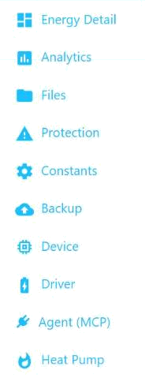
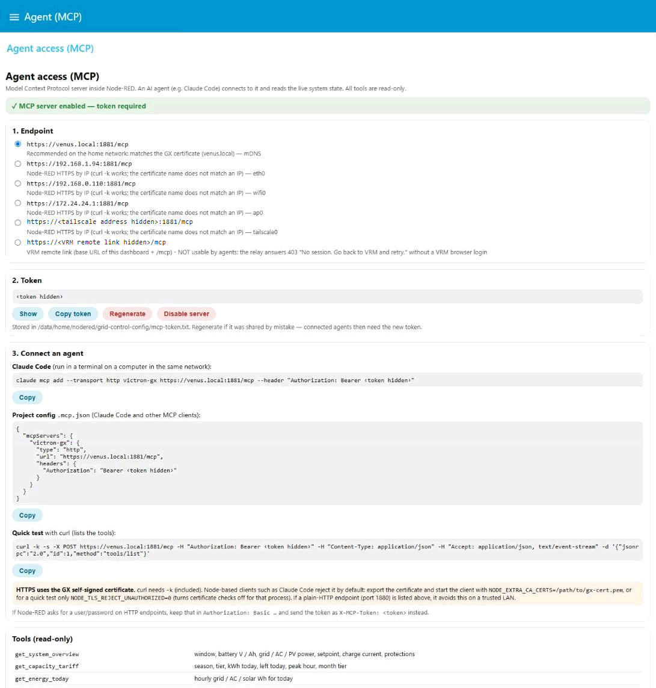
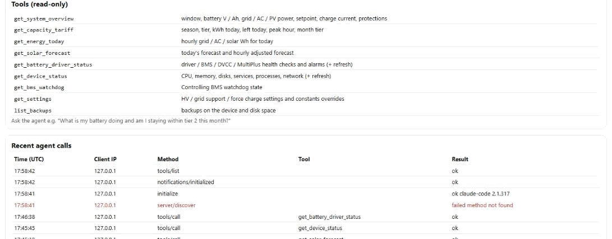
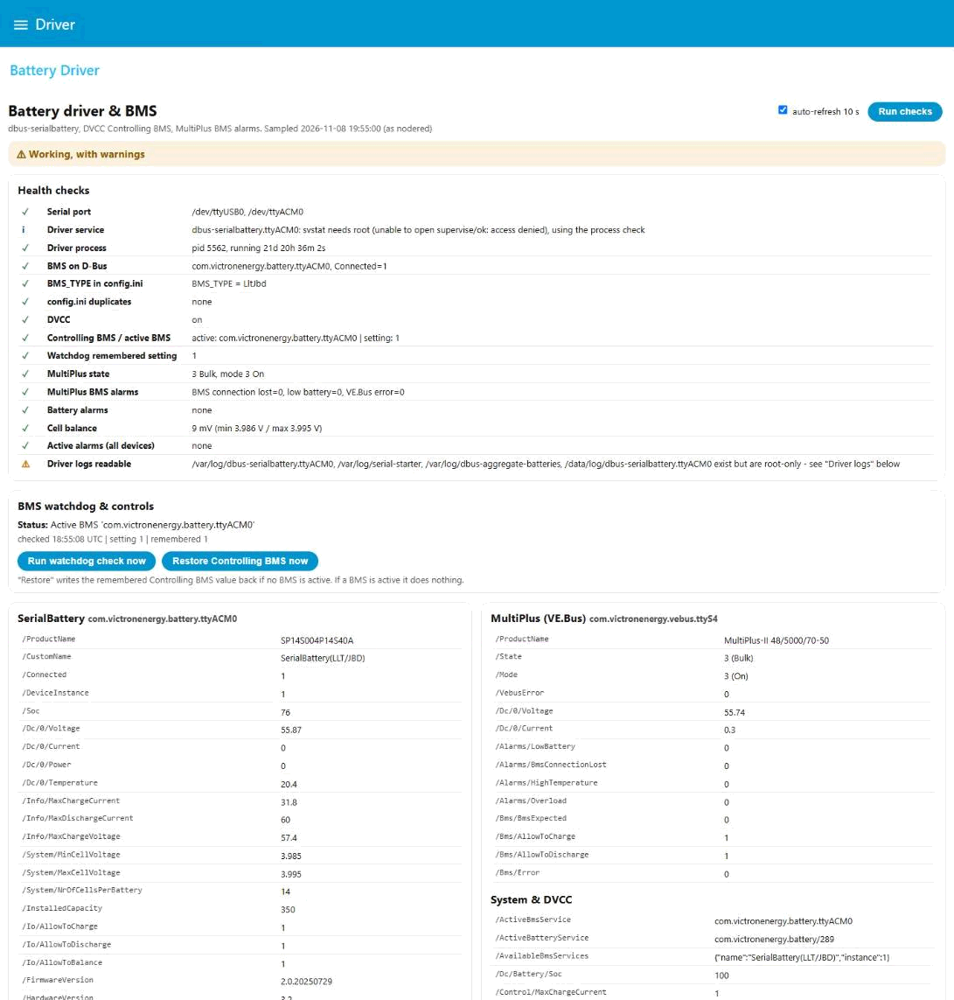
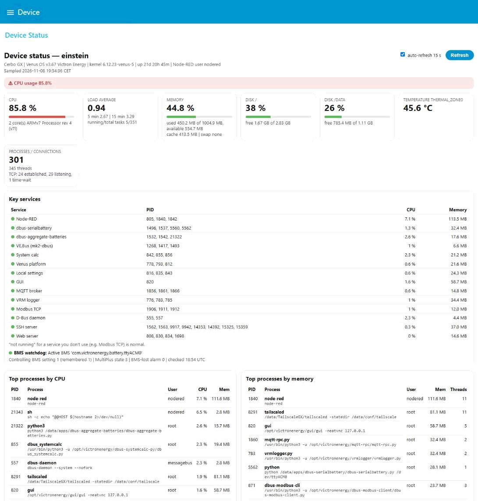
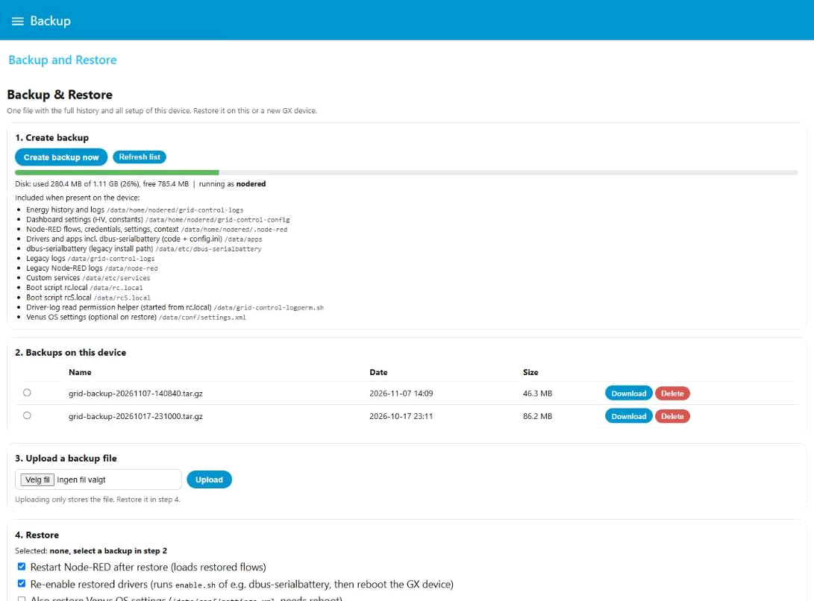
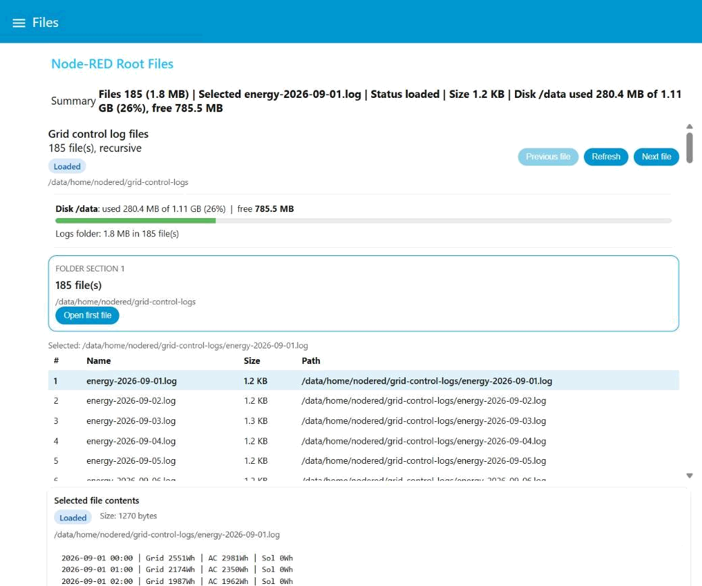
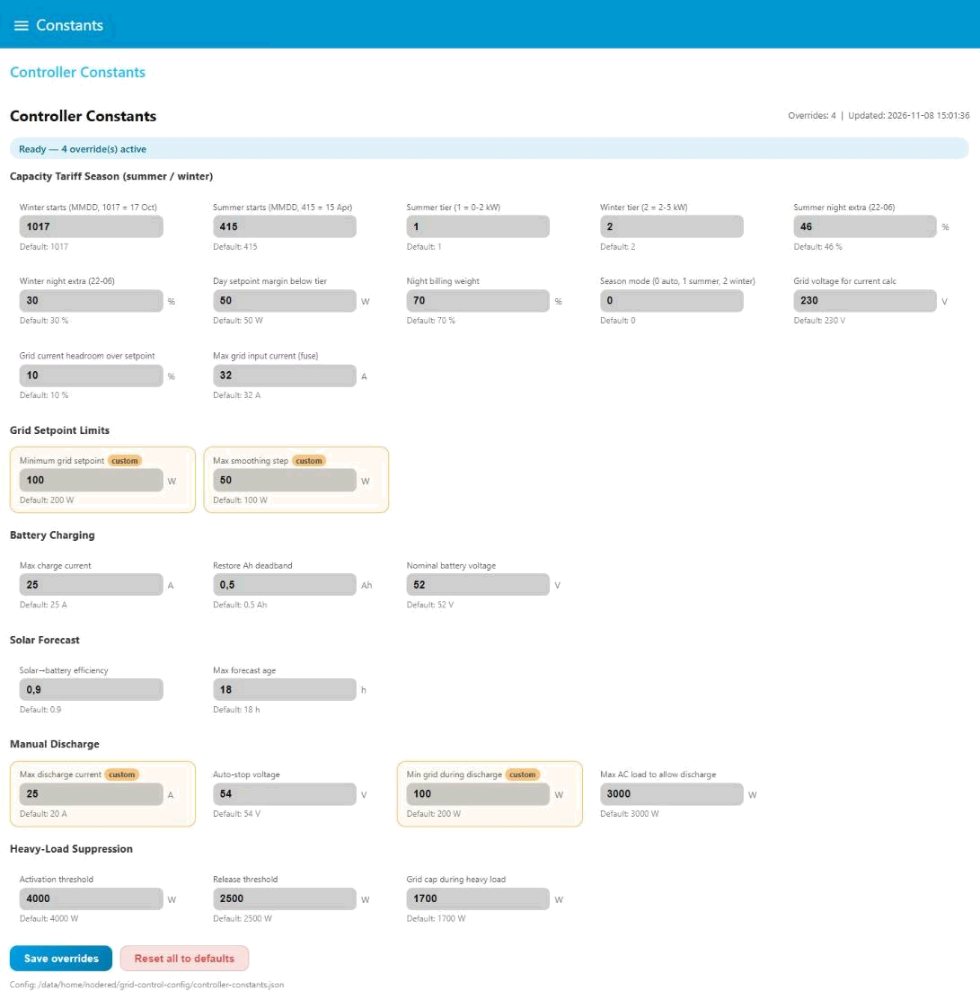
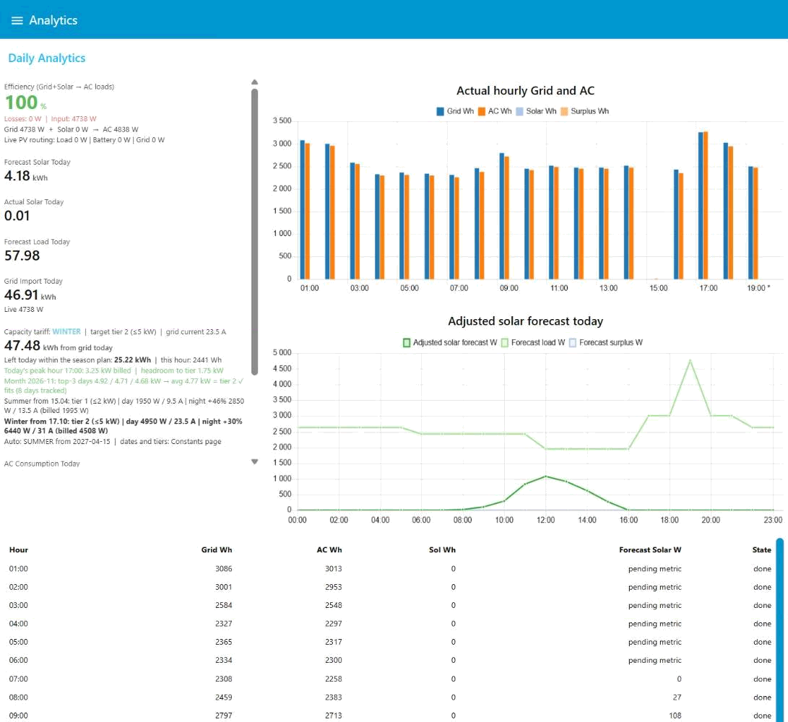
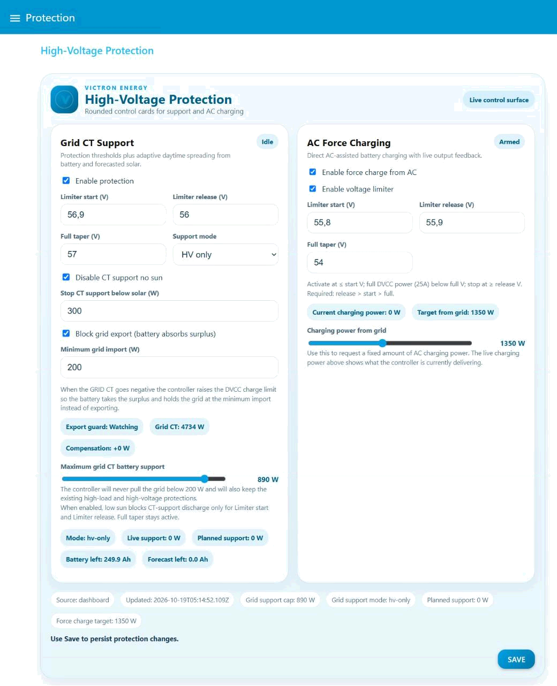

[Home](../README.md) · [Overview](overview.md) · [Control logic](control-logic.md) · [Tariffs](tariffs-norway.md) · **Dashboard** · [Device & driver](device-driver.md) · [Backup](backup-restore.md) · [Agent (MCP)](agent-mcp.md) · [Development](development.md) · [Limitations](limitations.md)

# Dashboard

> All dashboard pages with screenshots, Protection and Constants editors, persistence, data path

**On this page:**

- [Dashboard pages](#dashboard-pages)
  - [Agent (MCP) — connect an AI agent](#agent-mcp--connect-an-ai-agent)
  - [Driver — battery driver, BMS and MultiPlus health](#driver--battery-driver-bms-and-multiplus-health)
  - [Device — GX device health](#device--gx-device-health)
  - [Backup — backup and restore of the whole setup](#backup--backup-and-restore-of-the-whole-setup)
  - [Payback — savings and payback of the equipment](#payback--savings-and-payback-of-the-equipment)
  - [Devices — every device and sensor online](#devices--every-device-and-sensor-online)
  - [Files — logs and disk usage](#files--logs-and-disk-usage)
  - [Constants — controller constants and tariff seasons](#constants--controller-constants-and-tariff-seasons)
  - [Analytics dashboard](#analytics-dashboard)
- [Protection dashboard](#protection-dashboard)
  - [Grid CT Support card](#grid-ct-support-card)
  - [AC Force Charging card](#ac-force-charging-card)
- [Save and persistence behavior](#save-and-persistence-behavior)
- [Dashboard data path](#dashboard-data-path)
- [Controller Constants dashboard](#controller-constants-dashboard)

The live flow now includes several dashboard surfaces for operation and diagnostics, including a dedicated `Protection` tab for runtime control of the high-voltage limiter and AC-assisted charging.

## Dashboard pages

The **Heat Pump** page is described in the [README](../README.md#heat-pump-page-tuya-wi-fi-heat-pump) and in [Heat pump (Tuya, local)](heat-pump.md). Screenshots on this page: 8 Nov 2026, d#122.

### Agent (MCP) — connect an AI agent

Enables the built-in MCP server (`POST /mcp`) and shows everything needed to connect an agent: endpoint, token (show / copy / regenerate / disable), copy-ready `claude mcp add …`, `.mcp.json` and curl commands, the nine read-only tools and a log of the latest agent calls (the screenshot shows Claude Code 2.1.317 connecting). Use `https://venus.local:1881/mcp` from the home network — the GX certificate is issued to `venus.local`; the VRM remote link answers 403 "No session" to anything but a logged-in browser. In the screenshots the token is replaced by `‹token hidden›`. See [Agent access (MCP)](agent-mcp.md).

### Driver — battery driver, BMS and MultiPlus health

One page with every check used to diagnose the battery chain: serial port, driver process, BMS on D-Bus, `BMS_TYPE`, DVCC, Controlling BMS / active BMS, MultiPlus state and BMS alarms, cell balance and all active alarms — each marked ✓ / ⚠ / ✗. Below: live SerialBattery / MultiPlus / DVCC values, the BMS watchdog with `Run watchdog check now` and `Restore Controlling BMS now`, a repair-test timeline, the driver log viewer and copyable root-only SSH commands. See [Driver page](device-driver.md#driver-dashboard) and [BMS watchdog](device-driver.md#bms-watchdog).

### Device — GX device health

CPU (sampled over 1 s), load, memory, disks, temperature, uptime, Venus OS version, key Venus services with CPU / memory, top processes by CPU and memory, network rates, listening ports and external connections. Auto-refresh 15 s while the page is open. See [Device page](device-driver.md#device-status-dashboard).

### Backup — backup and restore of the whole setup

Creates one `.tar.gz` with the energy history, dashboard settings, Node-RED flows / credentials and the battery driver; download, delete, upload and restore it (with an automatic `pre-restore` backup and a root SSH command for a full restore on a new device). The card **Data archive by e-mail** mails the energy and heating data (last 7 / 31 days or all history) as a `.tar.gz` attachment, by a button and every Monday 07:00. See [Backup & restore](backup-restore.md).

### Payback — savings and payback of the equipment

Tab **Payback** (d#148; model `48 Payback model.js`, page `49 Payback page.html`). Reads the hourly energy history (`grid-control-logs/energy-YYYY-MM.csv` and the older `energy-YYYY-MM-DD.log`) once an hour and on open, and shows:

- equipment cost (EUR × EUR/NOK), saved so far, what is left, % paid back and a straight-line estimate of the payback (years, month);
- the saving split into **peak shaving** (monthly capacity step from the real grid peaks vs. from the house load), **solar** (solar kWh × energy price + grid energy charge of the hour) and **battery shift** (house load − grid import − solar, priced per hour: cheaper night import minus charge / discharge losses);
- a table per month: days with data, peak with / without the system, step with / without, the three parts and the total, grid and load kWh.

Model: all loads are behind the MultiPlus, so the AC load is what the house would import without the system (there is no export). Peak = average of the 3 highest billable hours on 3 different days, night 22–06 at the night factor (70 %). The current month counts as far as it has run. One fixed energy price is used (no hourly spot prices in the data). Not counted: backup power during outages.

Settings on the page (stored in `grid-control-config/payback.json`): equipment list in EUR, EUR → NOK, energy price, grid energy charge day / night, night factor, capacity step prices. Defaults: the owner's equipment (inverter 700, Cerbo GX 300, shunts 2 × 70, battery 1000, wires and cabinet 500, solar panels 350 EUR), Elvenett household tariff 2026 (steps 160 / 233 / 331 / 496 / 638 / 803 … kr per month, grid energy 35.16 / 16.41 øre/kWh day / night incl. taxes) — check them against elvenett.no.

### Devices — every device and sensor online

Tab **Devices** (d#151; model `50 Devices model.js`, page `51 Devices page.html`), refreshed every 2 min and on open. One card per device with online / offline, connection, IP and protocol, last data and key values:

- **Tuya on the local network** (no cloud): heat pump, boiler valve relay, exchanger bypass, SA1 power meter (from `heatPump` / `heatPumpModel` of `34`) and the two battery sensors (from the last local readings of `tools/tuya-local-sensors.js`, `grid-control-config/tuya-local-sensors-last.json`). Mains devices are online with data in the last 5 min, battery sensors with a local reading in the last 24 h (they report on a change and periodically). Battery: `battery_state` low / middle / high or %, *low* is marked red (≤ 20 %).
- **Victron on D-Bus**: every battery, VE.Bus, solar charger, system, meter and sensor service with product, custom name, connection, instance, firmware and a few values (one python call as user `nodered`, about 1.4 s).

- **All other Smart Life devices** (d#152): every device of the Smart Life account, read on the local network only. `tools/tuya-devices-setup.js` (run once on the GX as root, again after adding or re-pairing a device; `--sweep` pings the subnets first) takes from the Tuya cloud the device list, local keys, DP map (code, scale, unit) and MAC, finds the IP in the ARP table and writes `grid-control-config/tuya-devices.json` (with keys, mode 600) and `tuya-devices-meta.json` (no keys). Mains devices (plugs, breakers, meters, relays) are read by `tools/tuya-local-poll.js` in the Devices exec every 2 min (connect, take the DPs, disconnect; protocol 3.3 / 3.4 / 3.5 found automatically and remembered in `tuya-devices-ver.json`, last readings in `tuya-devices-last.json`); sleeping battery sensors (temperature / humidity, smoke detectors) by `tools/tuya-local-sensors.js` when they wake. The devices of the heat pump nodes are not polled (one local connection per device). Devices that are offline in Smart Life too are listed in their own section with the date the cloud last saw them (at setup).
- **Sensors without a local beacon** (d#153): some battery sensors (stair, stue, vlada and the two smoke detectors) wake for a few seconds, send their values to the Tuya cloud only and sleep again, without a UDP beacon the GX hears (one hour of listening on ports 6666 / 6667 / 7000 and the ARP table heard nothing from them while the cloud got new values; the exchange plate sensor was heard in the same hour). Only for these the Devices exec runs `tools/tuya-cloud-sensors.js`: at most every 30 min (about 6 cloud calls), only for battery sensors that were online in Smart Life at setup and have no local reading for 24 h; it writes `grid-control-config/tuya-devices-cloud.json` (values and the time the cloud got them, no keys). Their cards say *Tuya cloud (no local beacon)*; a local reading always wins. Smoke detectors report about once a day, so they count as online for 48 h.
- **Air quality** (d#156): the Qingping Air Monitor (Wi-Fi `192.168.1.58`, MAC `58:2D:34:70:1F:19`) has no open port, it only pushes. With a *Private Access Config* of type *self-built MQTT* on developer.qingping.co (host `192.168.1.94`, port `1883`, no user / password, up topic `qingping/{mac}/up`, down topic `qingping/{mac}/down`; assign the config to the device) it publishes its readings to the MQTT broker of the GX. The `mqtt in` node *Qingping air monitor (MQTT)* (`qingping/+/up`, broker `127.0.0.1:1883`) passes them to *Air monitor* (`52 Air monitor.js`), which keeps the last reading in flow `airMonitor`; the card shows CO2, PM2.5, PM10, tVOC (ppb), temperature and humidity and is online when the GX got data in the last 5 min. Only the known monitor MAC gets a card.

Report interval: the portal allows 10 min at least, so the monitor is set to 60 s by a **retained** command on its down topic: `{"type":"17","setting":{"report_interval":60,"collect_interval":60}}` to `qingping/582D34701F19/down` (the monitor answers with a type 28 message showing the settings). If the retained message is lost (broker store cleared), the monitor falls back to 15 min until the command is published again.

Security: the GX broker accepted LAN clients without a password before this feature (GX setting *MQTT on LAN*). The same broker serves the Venus `W/…` write topics, so any device on the LAN can change ESS / grid setpoint and current limits. Safer: GX security profile *Secured* (password-protected MQTT) with a username / password in the Qingping config and on `air-broker-01`, or a separate broker for `qingping/#` only. Not changed yet.

Low battery and sensors without a local reading for 24 h are also e-mailed by *Heat pump alerts* (`47`, see [Heat pump errors and e-mail alerts](heat-pump.md#errors-log-events-red-marks-e-mail-alerts-d145)).

### Files — logs and disk usage

Lists every file under `grid-control-logs` with its size, shows disk used / free for `/data` and the logs folder size, and previews the selected file. Nothing is deleted automatically — the full history is kept.

### Constants — controller constants and tariff seasons

Runtime editor for controller constants, including the capacity-tariff season (winter / summer start dates, tier per season, night extra %, grid current headroom and fuse limit). See [Constants editor](#controller-constants-dashboard).

### Analytics dashboard

## Protection dashboard

The `Protection` tab is meant for operational tuning without editing controller code.

It reads the active runtime settings from:

- `flow.highVoltageSettings`
- `/data/home/nodered/grid-control-config/high-voltage-settings.json`

The dashboard shows two rounded control cards:

1. `Grid CT Support`
2. `AC Force Charging`

### Grid CT Support card

This card controls the high-voltage limiter behavior and how much battery support is allowed on the GRID CT signal.

Available controls:

- `Enable protection`
- `Limiter start (V)`
- `Limiter release (V)`
- `Full taper (V)`
- `Maximum grid CT battery support`
- `Block grid export (battery absorbs surplus)`
- `Minimum grid import (W)`

Behavior:

- `Enable protection = off` disables the high-voltage limiter entirely
- when enabled, the limiter uses the configured `start`, `release`, and `full` voltages instead of fixed code constants
- `gridSupportW = 0` means the battery should not offset GRID CT import during voltage limiting
- `gridSupportW = 100` allows the controller to let the battery offset up to `100 W` dynamically on the GRID CT signal while the limiter is active
- `Block grid export` (on by default) never lets the GRID CT go negative: when export is detected the DVCC charge limit is raised so the battery absorbs the external MPPT surplus and the ESS setpoint is floored at `Minimum grid import`; the compensation integrates until the CT sits at the minimum import and releases itself when no longer needed
- `Minimum grid import (W)` is shared by the export guard and by adaptive CT support as the lowest grid import the controller will target (200–1000 W)

Displayed status:

- `Disabled` when protection is turned off
- `Idle` when protection is enabled but the voltage limiter is not active
- `Running` when the voltage limiter is currently active in the controller trace

### AC Force Charging card

This card provides a simple runtime way to request grid-assisted charging from AC.

Available controls:

- `Enable force charge from AC`
- `Charging power from grid`

Behavior:

- when enabled, the controller enters the `FORCE-CHARGE` operating window
- the requested grid setpoint becomes approximately `AC load + configured charging power`
- the requested charging power is converted to an approximate battery charging current using the live battery voltage
- if high-voltage protection becomes active, the force-charge request is tapered down by the same voltage limiter logic

Displayed status:

- `Disabled` when AC force charging is off
- `Armed` when enabled but not yet producing charge power
- `Running` when the controller trace reports active charging power

The `Current charging power` value is display-only and comes from the live controller trace. It reflects what the controller is actually commanding at that moment, not only the slider target.

## Save and persistence behavior

The Protection dashboard uses explicit save semantics.

That means:

- moving sliders does not immediately change the saved file
- pressing `Save` validates the values first
- valid settings are written to flow context and persisted to `/data/home/nodered/grid-control-config/high-voltage-settings.json`
- dashboard reload and reconnect repopulate the form from the persisted runtime settings

Validation currently enforces:

- voltage values must stay in the `50–60 V` range
- HV thresholds: `full > start >= release`
- FC limiter thresholds: `release > start > full`
- GRID CT support: `0–1000 W`
- AC force-charge power: `0–3000 W`

## Dashboard data path

The dashboard depends on the controller trace output to show live state.

Important trace-backed values include:

- voltage limiter active state
- current active window such as `NIGHT`, `MORNING`, or `FORCE-CHARGE`
- live charging power in watts
- final grid setpoint and final charge current

This is why the flow now uses a sixth controller output for structured trace data.

The main controller returns five outputs:

- DVCC charge current limit
- ESS grid setpoint
- a placeholder third output where `ac-input-current-limit` is emitted as `null`
- a notification/log message when the grid setpoint changes
- an hourly energy rollover message used by the energy log and daily summary writers
- a structured `controller-trace` payload used by the dashboard and analytics views

The VE.Bus Input 1 current limit is set by the controller from the tariff season (output 3, see [Control logic](control-logic.md#tariff-seasons-summer--winter)); the 06:00 / 22:00 inject nodes only trigger a recalculation.

The live flow now also reads the battery service path `com.victronenergy.battery/4 -> /ConsumedAmphours` and tags it as `battery-consumed-ah` for the controller.

## Controller Constants dashboard

The `Constants` tab is a runtime editor for the controller constants. Every field on the page is read by the controller on its next update (since d#154; before that only the tariff season group was applied and the other groups were stored but ignored).

Groups shown:

- **Capacity Tariff Season** — winter/summer start dates (MMDD), tier per season, night extra %, day margin, night billing weight, season mode, grid voltage / current headroom / max input current (read live by the controller)
- **Grid Setpoint Limits** — min setpoint, max high-voltage step per update
- **Battery Charging** — max charge current, restore Ah deadband, nominal battery voltage (fallback when no voltage is known)
- **Solar Forecast** — solar-to-battery efficiency, max forecast age
- **Manual Discharge** — max discharge current, auto-stop voltage, min grid during discharge, max AC load
- **Day High Load** — AC load threshold and the setpoint reduction above it (replaces the old Heavy-Load Suppression group, whose three values were never used by the controller)

The list of constants (label, default, range) lives in one place, `24 Build controller constants state.js`; `25` validates against it and the tests check that the controller (`01`) has the same defaults and ranges.

Behavior:

- on startup the node reads `/data/home/nodered/grid-control-config/controller-constants.json` (created automatically if missing)
- fields showing the default value have no override stored; only changed values are persisted
- `Save overrides` validates each field against its allowed range and writes non-default values to the JSON file
- `Reset all to defaults` clears the file and restores all defaults on the next cycle
- a value outside its range in the file is clamped by the controller (tiers, season mode and dates fall back to the default)
- the status line shows `Ready — N override(s) active`

---

← [Grid tariffs in Norway](tariffs-norway.md) | [Device, battery driver & BMS watchdog](device-driver.md) →
