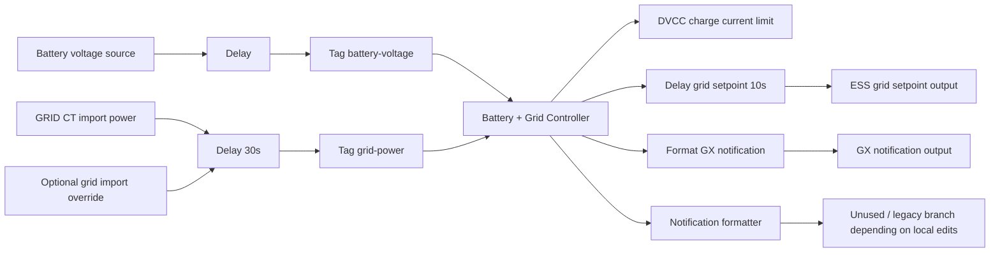

[Home](../README.md) · [Overview](overview.md) · [Control logic](control-logic.md) · [Tariffs](tariffs-norway.md) · [Dashboard](dashboard.md) · [Device & driver](device-driver.md) · [Backup](backup-restore.md) · [Agent (MCP)](agent-mcp.md) · **Development** · [Limitations](limitations.md)

# Development & deployment

> Repository layout, flow versioning, Node-RED architecture, sync and deploy workflow

**On this page:**

- [Repository contents](#repository-contents)
- [Node-RED architecture](#node-red-architecture)
  - [Notes](#notes)
- [Deployment workflow](#deployment-workflow)

## Repository contents

- `01 Battery + Grid Controller.js` … `33 MCP page.js`  
  Numbered human-readable source files for every Node-RED function node.  
  `sync-commands.ps1` provides `Sync-01` … `Sync-33` and `Sync-All` helpers.

- `garag-venus-os/1.txt`  
  dbus-serialbattery install, config and troubleshooting notes for the GX device.

- `flows.json`  
  Exported Node-RED flow used on Cerbo GX.

- `sync-commands.ps1`  
  PowerShell helpers: `. .\sync-commands.ps1` then `Sync-All` (or individual `Sync-NN`).

- `victron_elvenett_context.md`  
  Detailed design notes, tariff assumptions, and implementation history.

The repository keeps readable controller sources as numbered `.js` files (e.g. `01 Battery + Grid Controller.js`) and a live Node-RED export in `flows.json`.

Flow versioning rule:

- the Node-RED tab label in `flows.json` uses `d#<n>` as the live flow version marker
- every change to `flows.json` must increment that marker by 1
- this makes it visible in Node-RED which exported flow revision is currently loaded

## Node-RED architecture



### Notes

- `day-night.txt` should remain the readable master logic.
- `flows.json` should be synchronized after each controller update.
- Notification transport exists in the flow, but the local GX notification output may depend on service availability on the target Cerbo GX.

## Deployment workflow

Recommended workflow when editing the logic:

1. edit the relevant `NN FunctionName.js` file
2. synchronize into `flows.json` using `sync-commands.ps1`:
   ```powershell
   . .\sync-commands.ps1
   Sync-01   # or Sync-All to push every node at once
   ```
3. the `d#<n>` tab version is bumped automatically by the sync script
4. import or deploy the updated `flows.json` to the Cerbo GX
5. verify:
   - battery voltage input is updating
   - GRID CT import power is updating
   - status text shows correct hour range and `Wh`
   - charge current limit and grid setpoint change no faster than every 10 seconds

---

← [Agent access (MCP)](agent-mcp.md) | [Assumptions, limitations & roadmap](limitations.md) →
