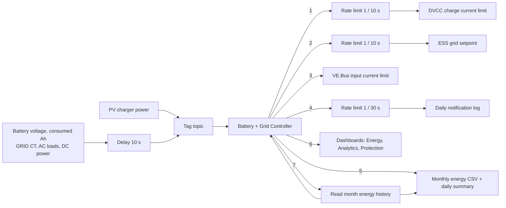

[Home](../README.md) · [Overview](overview.md) · [Control logic](control-logic.md) · [Tariffs](tariffs-norway.md) · [Dashboard](dashboard.md) · [Device & driver](device-driver.md) · [Backup](backup-restore.md) · [Agent (MCP)](agent-mcp.md) · **Development** · [Limitations](limitations.md)

# Development & deployment

> Repository layout, flow versioning, Node-RED architecture, sync and deploy workflow

**On this page:**

- [Repository contents](#repository-contents)
- [Node-RED architecture](#node-red-architecture)
  - [Notes](#notes)
- [Deployment workflow](#deployment-workflow)

## Repository contents

- `NN Name.js` (`01 Battery + Grid Controller.js` … `58 Record sensor temperatures.js`)
  One readable source file per Node-RED function node. The node name is the file name without the number.

- `NN Name.init.js` (`40 Heat pump automations.init.js`, `45 Compressor resource.init.js`)  
  The On Start code of that function node.

- `NN Name.html` (`35`, `39`, `41`, `43`, `49`, `51`, `53`, `55`, `59`)
  Sources of the heat pump, automation, Payback, Devices, Air quality and Temperatures `ui_template` pages. The other dashboard templates live only in `flows.json`. `57` reads sensor history; `58` records additional temperatures and schedules retention.

- `flows.json`  
  The Node-RED flow that runs on the Cerbo GX. Function code in it is generated from the sources.

- `tools/flows.js`  
  `sync` (sources → `flows.json`, bumps `d#<n>`), `check` (sync, syntax, wiring, outputs, Tuya secrets), `bump`, `version`.

- `tools/deploy-version.js`
  Adds source commit labels to a separate deployment payload, without deploying it or changing the tracked flow.

- `tools/gx/`
  The deploy scripts: `live-snapshot.js` (what the GX runs), `compare.js` (difference from a commit, deploy plan), `deploy.js` (selective deploy, dry run by default), `verify.js` (check after a deploy), `monitor.js` (health at any time; `scripts/gx-monitor.ps1` runs it from the PC). Step-by-step guide: [Deploying to the Cerbo GX](gx-deploy.md).

- `tests/`  
  Unit tests that run the function-node sources outside Node-RED (`tests/harness.js`: fake context / flow stores, fixed clock). No dependencies: `node --test "tests/*.test.js"`.

- `sync-commands.ps1`  
  PowerShell wrappers: `Sync-All`, `Sync-NN`, `Test-Flows`, `Get-FlowVersion`.

- `tools/heatpump-decode.js`  
  Decoder for the heat pump history files.

- `tools/sensor-history.js`
  Reads temperature/motion archives for a selected Oslo day, reports skipped
  invalid rows, and prunes only dated temperature JSONL files older than 400 days
  when explicitly invoked with `--prune` by the recorder's daily maintenance.

- `tools/elvenett-statistics.js`
  Fetches authenticated Elvenett data and reads private offline exports for
  historical capacity comparison on Payback.

- `tools/gx/deploy-local.js`
  Hash-checked selective deployment for an explicit owner request to deploy an
  uncommitted snapshot. No commit, push or automation-source relabelling.

- `config/gx/serialbattery-install-notes.txt`, `config/gx/dbus-serialbattery-config.ini`  
  dbus-serialbattery install, config and troubleshooting notes for the GX device.

- `victron_elvenett_context.md`  
  Detailed design notes, tariff assumptions, and implementation history.

Flow versioning rule:

- the Node-RED tab label in `flows.json` uses `d#<n>` as the live flow version marker
- every change to `flows.json` must increment that marker by 1 (`sync` does it; after a manual edit run `node tools/flows.js bump`)
- this makes it visible in Node-RED which exported flow revision is currently loaded

When the owner explicitly requests uncommitted local deployment iterations,
each build still increments once. A later commit records the latest build number,
not a renumbered or reused live version. Document the intermediate prepared/deployed
builds and backups in the work log and PR description. Subsequent changes increment
from that recorded number normally.

At deployment, also record the **full source commit SHA** for the dashboard and
Node-RED automations. `tools/deploy-version.js` shows 12-character versions in the
Node-RED editor tab label, alongside `d#<n>`. The dashboard header badge shows
the flow version and the dashboard Git SHA shortened to seven characters.
Full SHAs are stored in a marked JSON block in the version tab's `info`.
It preserves the existing code revision instead of incrementing `d#` again.

These are the source commits of the last deployment of each component, not a
claim that every file of a selectively updated GX matches one checkout.
A UI-only deployment retains the previous automation SHA, and vice versa.
For existing live code whose source was never recorded, the label explicitly
says `unrecorded`; never fill it with the current HEAD by assumption.

Function nodes cannot import code from each other, so a few tables exist in more than one source. They must stay equal, and the tests fail when they do not:

| Table | Sources |
|---|---|
| Controller constants (default, range) | `24` (the list the page and `25` use) and `CONSTANT_SPECS` in `01` |
| Protection settings (defaults, ranges, validation) | the marked block in `05` and `06`, the defaults in `07`, `sanitizeHighVoltageSettings` in `01` |
| MCP tool list | `TOOLS` in `32` and `TOOL_SUMMARY` in `33` |

## Node-RED architecture



### Editor layout (d#149–d#150)

All nodes of the main tab sit in Node-RED groups by function, each group laid out left to right (inputs → logic → outputs / pages):

- left column, energy: Energy controller (Victron inputs → Battery + Grid Controller → MultiPlus / ESS / DVCC), Energy pages, GX notifications and daily log, Solar forecast, Analytics, Protection (HV settings), Constants, Files, Backup (incl. data archive mail), Device / Driver / BMS watchdog, Agent (MCP)
- right column, heat pump: Tuya devices → state → Heat Pump page, recorder and history, battery sensors, automations and Automation log, compressor resource, e-mail alerts, Payback

`tools/layout-flows.js` makes this layout: group membership by node id (lists or id prefixes in `GROUPS`), layers by the longest wire path, order in a layer by barycenter, stable order from the position in `flows.json` (a second run gives the same file). It changes only `x`, `y`, `g` and the `group` nodes. After adding nodes, add their ids to a group, run `node tools/layout-flows.js flows.json flows.json layout-patch.json`, and deploy the patch by `GET /flows`, patch, `POST`. A new or changed `g` counts as a config change in Node-RED 3.1, so those nodes restart once (do not deploy during a DHW cycle); `x` / `y` alone restart nothing.

### Notes

- The numbered sources are the master; never edit function code in the Node-RED editor without copying it back.
- GX notifications (`Format GX notification`) are sent by the BMS watchdog and the test inject; grid setpoint changes are only written to the daily log.

## Deployment workflow

Recommended workflow when editing the logic:

1. edit the relevant `NN Name.js` / `.html` file, or the `lib/` file it includes. A line
   `// #include lib/heat-pump/heating-tick.js` in a source is replaced by that file's text when `flows.json` is built
   (`tools/includes.js`): the GX still gets one function node, the lib file is not a module and shares the node's
   scope. Each lib file is included by exactly one source; `//!` lines at its top are not embedded.
2. synchronize into `flows.json`:
   ```
   node tools/flows.js sync        # or: . .\sync-commands.ps1; Sync-All
   ```
   The `d#<n>` tab version is bumped once when something changed.
3. check and test:
   ```
   node tools/flows.js check
   node --test "tests/*.test.js"
   ```
   The same two commands run on every pull request (`.github/workflows/check.yml`).
4. deploy with `scripts/gx-deploy.ps1` (dry run first, then `-Apply`), see [GX deployment handoff](gx-handoff.md#operation-a-deploy-code). It runs the scripts in `tools/gx/` in a fixed order: snapshot, compare, plan, window, dry run, deploy, verify ([details](gx-deploy.md)). They do what the rest of this step describes.
   The deploy runner verifies the live flow against its recorded Git baseline,
   checks the safe window and saves `flows.json`, `flows_cred.json` and the
   original API response. It posts the whole target flow with the Git stamp,
   deterministic Tuya file-secret references, the v2 revision, and deployment type
   `nodes`. It never posts credentials. A revision conflict requires a new dry
   run. A failed readback or verification check triggers a flow rollback using
   the confirmed deployment revision. For manual recovery see
   [Rollback](gx-deploy.md#rollback). Secret-file-only installs leave the Git labels unchanged.
5. verify:
   - the live tab label shows the expected `d#<n>` and source SHA labels
   - dashboard page names are plain and the header badge shows the flow version
     and dashboard Git SHA; re-read the live flow's metadata and compare full
     SHAs with the deployed sources
   - battery voltage input is updating
   - GRID CT import power is updating
   - status text shows correct hour range and `Wh`
   - charge current limit and grid setpoint change no faster than every 10 seconds
   - the Heat Pump page shows the devices CONNECTED and the Automations page shows the same master / rule modes as before
---

← [Agent access (MCP)](agent-mcp.md) | [Assumptions, limitations & roadmap](limitations.md) →
