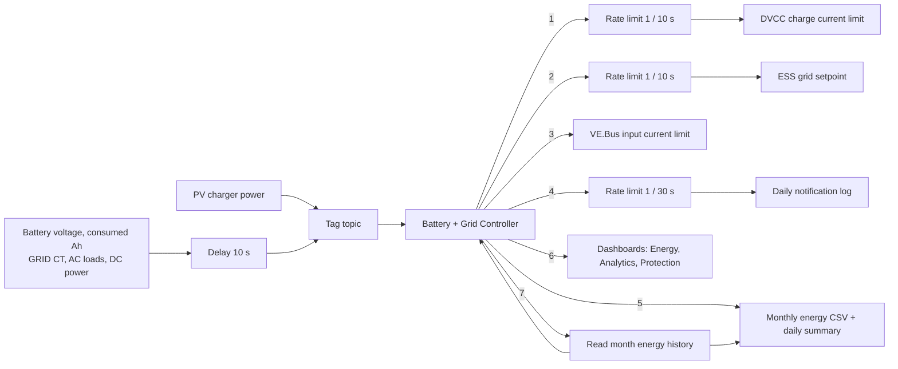

[Home](../README.md) · [Overview](overview.md) · [Control logic](control-logic.md) · [Tariffs](tariffs-norway.md) · [Dashboard](dashboard.md) · [Device & driver](device-driver.md) · [Backup](backup-restore.md) · [Agent (MCP)](agent-mcp.md) · **Development** · [Limitations](limitations.md)

# Development & deployment

> Repository layout, flow versioning, Node-RED architecture, sync and deploy workflow

**On this page:**

- [Repository contents](#repository-contents)
- [Node-RED architecture](#node-red-architecture)
  - [Notes](#notes)
- [Deployment workflow](#deployment-workflow)

## Repository contents

- `NN Name.js` (`01 Battery + Grid Controller.js` … `52 Air monitor.js`)  
  One readable source file per Node-RED function node. The node name is the file name without the number.

- `NN Name.init.js` (`40 Heat pump automations.init.js`, `45 Compressor resource.init.js`)  
  The On Start code of that function node.

- `NN Name.html` (`35`, `39`, `41`, `43`, `49`, `51`)  
  Sources of the heat pump, automation, Payback and Devices `ui_template` pages. The other dashboard templates live only in `flows.json`.

- `flows.json`  
  The Node-RED flow that runs on the Cerbo GX. Function code in it is generated from the sources.

- `tools/flows.js`  
  `sync` (sources → `flows.json`, bumps `d#<n>`), `check` (sync, syntax, wiring, outputs, Tuya secrets), `bump`, `version`.

- `tests/`  
  Unit tests that run the function-node sources outside Node-RED (`tests/harness.js`: fake context / flow stores, fixed clock). No dependencies: `node --test "tests/*.test.js"`.

- `sync-commands.ps1`  
  PowerShell wrappers: `Sync-All`, `Sync-NN`, `Test-Flows`, `Get-FlowVersion`.

- `tools/heatpump-decode.js`  
  Decoder for the heat pump history files.

- `garag-venus-os/1.txt`, `dbus-serialbattery-config.ini`  
  dbus-serialbattery install, config and troubleshooting notes for the GX device.

- `victron_elvenett_context.md`  
  Detailed design notes, tariff assumptions, and implementation history.

Flow versioning rule:

- the Node-RED tab label in `flows.json` uses `d#<n>` as the live flow version marker
- every change to `flows.json` must increment that marker by 1 (`sync` does it; after a manual edit run `node tools/flows.js bump`)
- this makes it visible in Node-RED which exported flow revision is currently loaded

Function nodes cannot import code from each other, so a few tables exist in more than one source. They must stay equal, and the tests fail when they do not:

| Table | Sources |
|---|---|
| Controller constants (default, range) | `24` (the list the page and `25` use) and `CONSTANT_SPECS` in `01` |
| Protection settings (defaults, ranges, validation) | the marked block in `05` and `06`, the defaults in `07`, `sanitizeHighVoltageSettings` in `01` |
| MCP tool list | `TOOLS` in `32` and `TOOL_SUMMARY` in `33` |

## Node-RED architecture



### Editor layout (d#149–d#150)

All nodes of the main tab sit in Node-RED groups by function, each group laid out left to right (inputs → logic → outputs / pages):

- left column, energy: Energy controller (Victron inputs → Battery + Grid Controller → MultiPlus / ESS / DVCC), Energy pages, GX notifications and daily log, Solar forecast, Analytics, Protection (HV settings), Constants, Files, Backup (incl. data archive mail), Device / Driver / BMS watchdog, Agent (MCP)
- right column, heat pump: Tuya devices → state → Heat Pump page, recorder and history, battery sensors, automations and Automation log, compressor resource, e-mail alerts, Payback

`tools/layout-flows.js` makes this layout: group membership by node id (lists or id prefixes in `GROUPS`), layers by the longest wire path, order in a layer by barycenter, stable order from the position in `flows.json` (a second run gives the same file). It changes only `x`, `y`, `g` and the `group` nodes. After adding nodes, add their ids to a group, run `node tools/layout-flows.js flows.json flows.json layout-patch.json`, and deploy the patch by `GET /flows`, patch, `POST`. A new or changed `g` counts as a config change in Node-RED 3.1, so those nodes restart once (do not deploy during a DHW cycle); `x` / `y` alone restart nothing.

### Notes

- The numbered sources are the master; never edit function code in the Node-RED editor without copying it back.
- GX notifications (`Format GX notification`) are sent by the BMS watchdog and the test inject; grid setpoint changes are only written to the daily log.

## Deployment workflow

Recommended workflow when editing the logic:

1. edit the relevant `NN Name.js` / `.html` file
2. synchronize into `flows.json`:
   ```
   node tools/flows.js sync        # or: . .\sync-commands.ps1; Sync-All
   ```
   The `d#<n>` tab version is bumped once when something changed.
3. check and test:
   ```
   node tools/flows.js check
   node --test "tests/*.test.js"
   ```
   The same two commands run on every pull request (`.github/workflows/check.yml`).
4. make a backup (the **Backup** page, or a copy of `flows.json` and `flows_cred.json` on the GX), then deploy. The way used for this installation: a script on the GX reads the live flow from the Node-RED admin API (`GET /flows`), replaces only the changed nodes (same node ids) and posts it back with deploy type `nodes`. The Tuya keys stay in place and only the changed nodes restart. A full *Import → Replace* also works, but do not replace the Tuya nodes that already have keys ([why](../README.md#heat-pump-page-tuya-wi-fi-heat-pump)). Do not deploy the heat pump automation nodes while a DHW cycle runs. Rollback = put the two saved files back and restart Node-RED.
5. verify:
   - the tab label shows the new `d#<n>`
   - battery voltage input is updating
   - GRID CT import power is updating
   - status text shows correct hour range and `Wh`
   - charge current limit and grid setpoint change no faster than every 10 seconds
   - the Heat Pump page shows the devices CONNECTED and the Automations page shows the same master / rule modes as before
---

← [Agent access (MCP)](agent-mcp.md) | [Assumptions, limitations & roadmap](limitations.md) →
