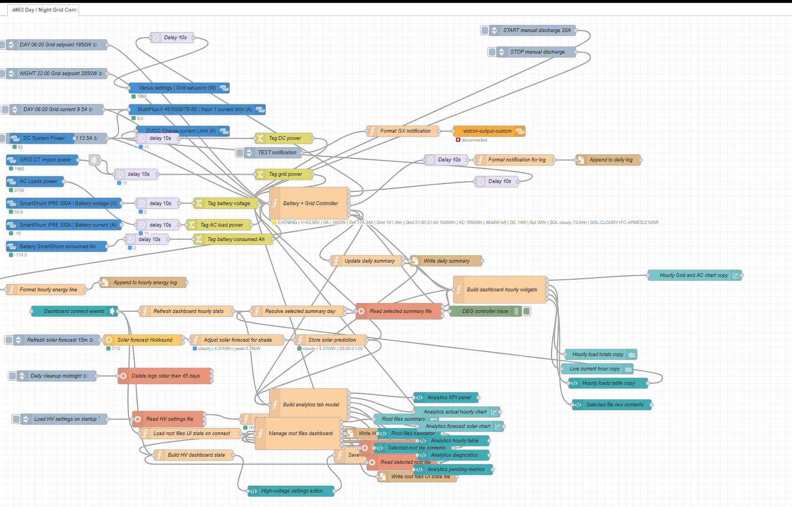
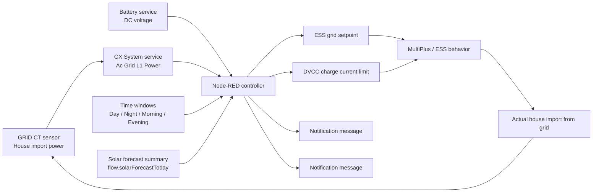
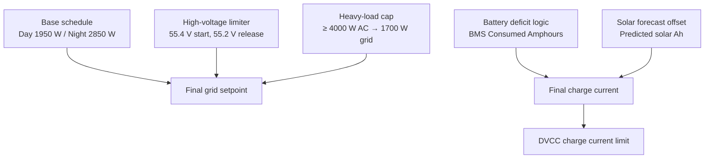

[Home](../README.md) · **Overview** · [Control logic](control-logic.md) · [Tariffs](tariffs-norway.md) · [Dashboard](dashboard.md) · [Device & driver](device-driver.md) · [Backup](backup-restore.md) · [Agent (MCP)](agent-mcp.md) · [Development](development.md) · [Limitations](limitations.md)

# Overview & architecture

> Goal, signal flow, control layers

**On this page:**

- [Goal](#goal)
- [High-level architecture](#high-level-architecture)
  - [Current Node-RED flow](#current-node-red-flow)
  - [Main signal flow](#main-signal-flow)
- [Control layers](#control-layers)
  - [Priority order](#priority-order)

## Goal

The main operational goal is to keep hourly raw grid import under practical limits that fit Norwegian capacity-based network tariffs, while still charging the battery when needed.

The current design target depends on the tariff season (switched automatically by date):

- summer (from 15 Apr, tier 1 ≤ 2 kW): day `1950 W` / `9.5 A`, night `2850 W` / `13.5 A`
- winter (from 17 Oct, tier 2 ≤ 5 kW): day `4950 W` / `23.5 A`, night `6440 W` / `31 A` (+30 %)
- night is allowed to be higher because this project was tuned around an Elvenett-style reduced night weighting factor (`0.7`)

This logic is especially useful when:

- the house has a battery bank
- the inverter/charger can import from grid under ESS control
- the user wants to avoid expensive monthly capacity steps caused by a few high hourly peaks

## High-level architecture

### Current Node-RED flow

### Main signal flow

1. Cerbo GX exposes live data from the battery and GRID CT sensor.
2. Node-RED reads:
   - battery voltage
   - grid import power measured by the house CT sensor
   - current time
3. The controller calculates:
  - how many Ah the battery still needs to restore from the BMS net consumed-Ah reading
  - whether the remaining deficit must be charged now in NIGHT, or can wait for MORNING
  - how much predicted solar energy can offset that remaining grid-charging need
   - the final grid setpoint
   - the hourly imported energy used so far
4. The outputs are written back into Victron settings and VE.Bus controls.
5. Actual import changes and the loop repeats.

## Control layers

The controller is not a single rule. It is a stack of limits.

### Priority order

The final grid setpoint is the minimum of:

1. base schedule
2. high-voltage limiter
3. heavy-load cap (active when AC loads ≥ 4000 W)

Hourly imported energy is still tracked and shown in status text, but it is display-only and does not override the schedule.

---

← [Home](../README.md) | [Control logic](control-logic.md) →
